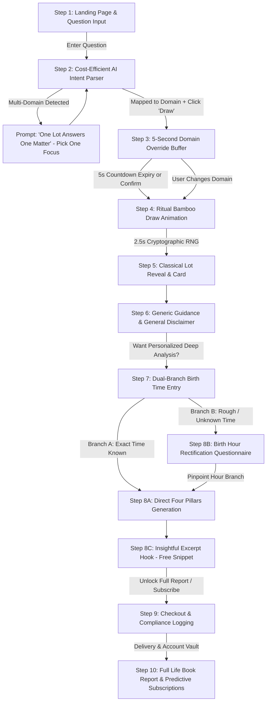

# 02. The Ten-Step User Journey Specification

This document details the exact 10-step user journey, wireframe logic, state transitions, and UI copy specifications.

---

## Journey Overview Diagram

---

## Step 1 · Landing Page & Question Input (落地页与提问)

### Primary Elements & UX Flow
- **Hero Statement**:
  > *"The Sixty Jiazi Lots of the Mazu temple tradition — bring your contemplation, let classical archetypes illuminate your path."*
- **Frictionless Question Entry Box**:
  - Accessible to guest visitors and logged-in users alike with zero barrier.
  - Placeholder: *"Enter what is on your heart (e.g. 'Considering changing careers this autumn' or 'How to navigate relationship friction')..."*
- **Primary CTA Button**:
  > `[ Inquire & Draw / 诚心求签 ]`
- **Positioning Statement & Trust Anchors**:
  - *"Cultural heritage and reflective guidance — not a prediction of deterministic events."*
  - Authentic Classical Philology: 60 Historical Allusions & Original Verses.
  - Cryptographic Randomness: Zero backend bias (`crypto.getRandomValues`).

---

## Step 2 · Cost-Efficient AI Intent Parsing & Domain Gate (智能意图解析与分流)

### Architecture & Behavior
1. **Cost-Efficient Intent Parser**:
   - The user's query is processed via a hybrid pipeline:
     - **L1 (Client-side regex)**: Matches keywords against canonical lists (`domKw.json`).
     - **L2 (Cost-efficient LLM API)**: Fast, economical model (e.g. FreeLLMAPI, DeepSeek, or compact OpenAI-compatible endpoint) to extract underlying human intent.
   - Maps the question into one of 13 canonical domain slots (`relationships`, `career`, `money`, `health`, `family_home`, `travel_moving`, `sea_and_voyage`, `the_absent_one`, `legal`, `conception`, `timing`, `livelihood_and_seasons`, `general`).
2. **Multi-Domain Guardrail ("一籤斷一事" / "One Lot Answers One Matter")**:
   - If the intent parser detects that the question addresses multiple unrelated domains (e.g., *"Will my company get funded and will my boyfriend propose?"*), the draw is halted.
   - **User Prompt**:
     > *"Traditional wisdom teaches that **one lot answers one matter (一籤斷一事)**. Your query touches on both Finance/Business and Relationships. Please select which matter you would like to focus on for this draw."*
   - User clicks one domain to proceed or edits their question.

---

## Step 3 · 5-Second Domain Override Buffer (5秒意向确认与调选窗口)

### UX Behavior & State Machine
1. When the user clicks the draw CTA, the screen shifts into a focused confirmation modal / card.
2. The UI clearly states:
   > **Detected Domain**: `[ 💼 Career & Purpose (事业与学业) ]`  
   > *"Drawing in 5 seconds... Not what you meant? Click below to change."*
3. **Interactive 5-Second Countdown**:
   - A smooth circular or bar countdown animation counts down `5... 4... 3... 2... 1...`.
   - The user can click any other domain badge from the 13-domain grid to instantly override the AI classification.
   - The user can click `[ Draw Now ]` to immediately skip the timer.
4. When the timer reaches 0 or user confirms, the draw sequence initiates automatically.

---

## Step 4 · Ritualized Draw (仪式化抽签)

### UX & Animation Specifications:
- **Visuals**: A finely textured obsidian bamboo cylinder (签筒) rendered with fluid CSS/SVG animation.
- **Duration**: 2.5 seconds of rhythmic shaking with subtle wooden clattering audio and haptic pulses.
- **Randomness Mechanics**:
  - `window.crypto.getRandomValues(new Uint32Array(1))` normalized to uniform integer `1..60`.
- **Session Locking (Anti-Spam)**:
  - Preserves session integrity: only 1 lot drawn per question context to prevent result-shopping.

---

## Step 5 · The Lot Reveal (出签)

A hero card displaying canonical lot metadata:
- **Card Header**: Lot Serial Number (1–60), Jiazi stem-branch (e.g., `Lot 27 · 戊辰 Wu-Chen`), Hexagram (`陸, Lu`).
- **Authentic Seal Stamp**: 2×2 Qin Small Seal (`戊辰二七`).
- **Historical Allusion Story**: Title (e.g., `胡完救文氏母女`) and 2-sentence classical synopsis.
- **Poetic Quatrain**: 4-line classical verse alongside curated unrhymed English translation.

---

## Step 6 · Generic Guidance & General Disclaimer (通用解曰与免责声明)

### Core Sections:
1. **Domain Guidance Line (`jie` / 解曰)**:
   - Displays the classical guidance corresponding strictly to the confirmed domain.
2. **Dual-Cluster Keywords**:
   - `FAVOURABLE`: *Self-reliance, mid-month resolution, quiet perseverance.*
   - `GUARDED`: *External dependency, excessive anxiety before the appointed time.*
3. **Prominent General Disclaimer (通用解读免责声明)**:
   > ⚠️ **Important Disclaimer**: *"This interpretation is a general reading based on the lot's classical literature and historical allusions. It provides reflective philosophical counsel rather than deterministic predictions. To understand how this lot resonates with your specific energetic makeup and life timing, personalized birth chart analysis is required."*
4. **Domain Compliance Flags**:
   - Automatic statutory notices attached for health (`not_medical_advice`), financial (`not_financial_advice`), and legal (`not_legal_advice`).

---

## Step 7 · The Bridge to Personalization (双分支生辰接入)

Positioned directly below the generic guidance:

> ### *"This lot provides general counsel. What does it reveal within YOUR unique chart?"*
>
> By cross-referencing this Lot's stem-branch (干支) with your birth chart and current planetary transits, our engine calculates:
> - **Palace Resonance (签 × 命局)**: Hidden harmonies, clashes with your relationship or career palaces.
> - **Strategic Timing Windows (签 × 流年)**: The seasonal quarters and trigger years (`应期`) when this matter culminates.

### Dual-Branch Input Selection:
- **Branch A: "I know my exact birth time"**
  - Inputs: Year, Month, Day, Hour, Minute, and Birth City/Country (for True Solar Time offset).
  - Skips directly to Step 8C.
- **Branch B: "I only know approximate time / Don't know"**
  - Inputs: Year, Month, Day, Birth City/Country.
  - Coarse Time Selection:
    - `[ 🌅 Morning / 早 (05:00 - 11:00) ]` (卯、辰、巳时)
    - `[ ☀️ Afternoon / 午 (11:00 - 17:00) ]` (午、未、申时)
    - `[ 🌙 Night / 晚 (17:00 - 23:00) ]` (酉、戌、亥时)
    - `[ ❓ Not Sure / 不清楚 ]` (All 12 hours considered)
  - Enters Step 8B: Birth Hour Rectification.

---

## Step 8 · Birth Hour Rectification & Insightful Excerpt Hook (考时定盘与高价值试读)

### Step 8B: Birth Hour Rectification Workflow (时辰逆推 / 考时定盘)
1. **Candidate Hour Expansion**:
   - The engine generates 3 to 12 candidate Four Pillars charts from the selected interval.
2. **Milestone Calculation (`verdict.py:converge()` Kernel)**:
   - For each candidate chart, the engine calculates the historical milestone event years (`应期` / `引动年`), tracking high-impact interactions:
     - 夫妻宫 (Day Branch) clashes/combinations (relationship milestones, marriages, splits).
     - 子女宫 / 事业宫 (Hour Branch) interactions (career promotions, major moves, relocations).
     - 财库 (辰戌丑未) opening/closing (major asset gains or financial shifts).
3. **Targeted Past-Event Questionnaire**:
   - The UI presents 2–3 brief, high-contrast historical milestone questions:
     - *Question 1: "Between 2017 and 2019, did you experience a major change in residence, city, or career role?"*
     - *Question 2: "In 2021 (辛丑年), did you undergo a significant relationship milestone or domestic transformation?"*
4. **Mathematical Convergence**:
   - Based on user selections, the system eliminates non-matching branches and **locks the exact birth hour pillar** (*定盘完成*).

### Step 8C: The Convincing Insightful Excerpt Hook (免费深度试读)
- Before showing the paywall, the system generates a **brief but deeply insightful structural snippet** (2–3 sentences) using `verdict.py:settle_nature()` and `main_verdicts()`:
  > *"Your chart reveals a potent structural tension between creative autonomy and established hierarchy. Historical milestones show that major turning points in your life (such as 2018–2019) were sparked when external constraints forced you to claim your own domain..."*
- This brief, shockingly accurate insight acts as the ultimate conversion hook.

---

## Step 9 · Checkout & Compliance Logging (结账与交付)

### Offer Structure:
- **Tier 1: Single Full Life Book Report ($2.99 launch trial / $19.99 standard)**:
  - Unlocks complete 9-section Life Book Report (`layers_mingshu.py`).
  - High-resolution PDF export sent to registered email.
  - Permanent storage in user account vault.
- **Tier 2: Event-Triggered Predictive Annual Subscription ($9.99 – $11.99/mo)**:
  - Includes full report + continuous proactive predictive alerts triggered by upcoming milestone windows (`应期` / `引动年`) and Solar Terms (节气).
- **Payment & Compliance**:
  - Stripe checkout (Credit/Debit, Apple Pay, Google Pay).
  - Explicit EU CRD Art. 16(m) immediate delivery waiver checkbox.

---

## Step 10 · Full Report Delivery & Predictive Subscriptions (报告交付与订阅生命周期)

1. **Interactive Life Book Report**:
   - Beautiful multi-tabbed web report rendering:
     - Section 1: 命局定性 (Life Structure Character & Temperament)
     - Section 2: 事业与学业 (Career, Role & Industry Direction)
     - Section 3: 财富机制 (Wealth Architecture & Cashflow Dynamics)
     - Section 4: 感情婚姻 (Partnership & Palace Interactions)
     - Section 5: 六亲家庭 (Family & Interpersonal Dynamics)
     - Section 6: 身心健康 (Five Elements Balance)
     - Section 7: 做功与厚化 (Core Action Capacities)
     - Section 8: 大运走势 (10-Year Major Luck Cycles)
     - Section 9: 流年关键窗口与应期 (Annual Milestone Windows)
2. **Event-Triggered Lifecycle Alerts**:
   - Automated emails / push notifications whenever astronomical events (annual pillar transits, solar terms) align with the user's natal trigger points.

---

## 🧭 Planning Navigation (Relative Links)
- [00. Executive Summary](./00_EXECUTIVE_SUMMARY.md)
- [01. Product Requirements Document](./01_PRODUCT_REQUIREMENTS_DOCUMENT.md)
- [02. Ten-Step User Journey Specification](./02_TEN_STEP_USER_JOURNEY_SPEC.md)
- [03. Personalization Engine Specification](./03_PERSONALIZATION_ENGINE_SPEC.md)
- [04. Domain Mapping & Question Gate Specification](./04_DOMAIN_MAPPING_AND_QUESTION_GATE.md)
- [05. Technical Architecture & Multi-Platform Strategy](./05_TECHNICAL_ARCHITECTURE_AND_MULTI_PLATFORM.md)
- [06. Compliance, Legal & Payment Specifications](./06_COMPLIANCE_LEGAL_AND_PAYMENTS.md)
- [07. Project Roadmap & Milestones](./07_PROJECT_ROADMAP_AND_MILESTONES.md)
- [Root README](../../README.md)

