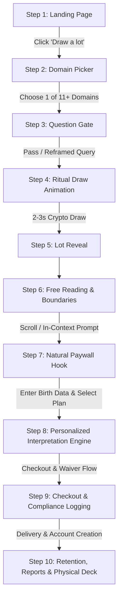

# 02. The Ten-Step User Journey Specification

This document details the exact 10-step user journey, wireframe logic, state transitions, and UI copy specifications.

---

## Journey Overview Diagram



---

## Step 1 · Landing Page (落地页)

### Primary Elements & Copy
- **Hero Statement**:
  > *"The Sixty Jiazi Lots of the Mazu temple tradition — draw a lot, then read it in the light of your own chart."*
- **Primary CTA Button**:
  > `[ Draw a Lot ]` (Zero friction, no login required, prominent placement).
- **Positioning Statement (Footer Anchor)**:
  > *"Cultural heritage and reflective guidance — not a prediction of events."*
  *(Derived from `llms.txt`, permanent on all landing surfaces).*
- **Value Trust Badges**:
  - Authentic Classical Philology: 60 Historical Allusions & Original Verses.
  - Ethical Agency: AI Question Reframing for Mindful Inquiry.
  - Cryptographic Randomness: Zero backend bias.

---

## Step 2 · Domain Picker (选问事域)

### UX Behavior
The user chooses what area of life they are inquiring about. The user interface presents 11 primary modern English slots mapped cleanly from the 29 traditional Chinese temple categories:

| # | English Slot ID | Modern Display Label | Mapped Traditional Chinese Category (传统类目) | Automated Compliance Tag |
| :--- | :--- | :--- | :--- | :--- |
| 1 | `career` | Career & Purpose | 功名 / 作事 | — |
| 2 | `money` | Finance & Wealth | 求財 | *Not financial advice* |
| 3 | `relationships` | Love & Partnership | 婚姻 | — |
| 4 | `health` | Health & Vitality | 治病 | *Not medical advice* |
| 5 | `legal` | Legal & Disputes | 官事 | *Not legal advice* |
| 6 | `family_home` | Family & Domestic Life | 家事 / 家運 | — |
| 7 | `conception` | Fertility & Childbearing | 求兒 / 六甲 | *No medical outcomes implied* |
| 8 | `travel_moving` | Relocation & Travel | 出外 / 移居 / 築室 | — |
| 9 | `business` | Business & Commerce | 經商 | — |
| 10 | `timing` | Timing & Seasonal Cycles | 歲君 / 月令 | *Seasonal windows only; no exact dates* |
| 11 | `sea_and_voyage` | Sea & Voyages (Mazu Domain) | 討海 / 行舟 | — (Dedicated Mazu coastal heritage slot) |
| 12 | `livelihood_and_seasons` | Projects & Agriculture | 耕作 / 六畜 / 魚苗 / 作塭 | — |
| 13 | `loss_and_recovery` | Missing Items & Reconnection | 失物 / 尋人 / 來人 / 遠信 | *Reframe third-party to self-agency* |

*Note: The canonical 29-category mapping matrix is maintained in `定本/类目映射_29类目_to_slots.csv`.*

---

## Step 3 · Question Gate (问法治理闸门)

### Why It Matters
This is an industry-first proprietary differentiator. Rather than acting as a passive lottery, the platform guides the seeker toward clarity, honesty, and personal agency before drawing.

### Rules Enforced by the Gate:
1. **One Matter Per Draw (一问一事)**:
   - If the user enters multiple topics (e.g. *"Will I get a promotion and will my partner propose?"*), the gate flags this and requests the user to pick one issue.
   - *Prompt*: *"One lot answers one matter. Please focus on your single most pressing contemplation."*
2. **Transform Closed & Fatalistic Questions into Open Inquiries (封闭式问句当场改写)**:
   - Closed query: *"Will he love me?"*
   - Reframed query: *"What should I keep in view about this relationship, and what is mine to do?"*
   - Closed query: *"Will I become rich this year?"*
   - Reframed query: *"How can I cultivate financial stability and right effort in this season?"*
3. **Third-Person Shift to Self-Agency (第三人问法转自我视角)**:
   - Third-person query: *"Will my boss stop micromanaging me?"*
   - Reframed query: *"How can I establish clear boundaries and professional communication with my leadership?"*
4. **Radical Transparency**:
   - The transformation is not hidden. The UI displays:
     > **Original Question**: *"Will he love me?"*
     > **Reframed Inquiry**: *"What should I keep in view about this relationship, and what is mine to do?"*
     > **Why**: *"Traditional wisdom acts as a mirror for your own actions and perception, rather than predicting another person's sovereign choices."*
     > `[ Proceed with this Inquiry ]` or `[ Edit Question ]`

---

## Step 4 · Ritualized Draw (仪式化抽签)

### UX & Animation Specifications:
- **Visuals**: A finely textured bamboo cylinder (签筒) rendered with subtle 3D lighting or fluid SVG animation.
- **Duration**: 2.2 to 3.0 seconds of rhythmic shaking. Sound effects (bamboo sticks clattering) with a mute toggle.
- **Randomness Mechanics**:
  - Generated via `window.crypto.getRandomValues(new Uint32Array(1))` normalized to an integer between `1` and `60`.
  - **FAQ Transparency**:
    > *"Every draw uses cryptographic client-side randomness. The insight of a reading does not stem from an algorithm picking a lucky number, but from how the classical archetypes illuminate your specific question and birth chart."*
- **Session Locking (Anti-Spam)**:
  - Within a single browser session / localStorage state, users cannot re-draw for the exact same inquiry domain within 12 hours.
  - Prevents "result-shopping" until a pleasing answer is obtained, preserving psychological weight and contemplative integrity.

---

## Step 5 · The Lot Reveal (出签)

A single hero card displaying canonical lot metadata.

> **Language & Display Governance**: By default, the card and reading display strictly in the user's preferred language (e.g. English) with essential cultural anchors retained as subtle glosses (`Wu-Chen (戊辰)`, `Hu Wan Rescues the Widow Wen (胡完救文氏母女)`). Full parallel bilingual text is isolated to the opt-in **Bilingual Study Mode (雙語對照模式)** to eliminate visual clutter.

```
┌─────────────────────────────────────────────────────────────────────────────┐
│  LOT 27 · WU-CHEN (戊辰) · HEXAGRAM LU (陸 · HEAVEN OVER LAKE)              │
│  Canonical Gloss: 胡完救文氏母女 (Hu Wan Rescues Widow Wen & Daughter)      │
│  Element & Direction: Earth · Favours Late Summer; Southwest Auspicious     │
│  Editorial Tone: Favourable (Positive Flow)                                 │
├─────────────────────────────────────────────────────────────────────────────┤
│  CONTEMPLATIVE VERSE (POETIC TRANSLATION):                                  │
│  "Why must you inquire after sacred portents?                               │
│   Within your own heart lies already what is of benefit.                    │
│   For now, look toward the middle of the lunar month:                       │
│   Calamity shall fall away, transforming into auspicious ease."             │
│                                                                             │
│  [📜 View Original 7-Character Traditional Verse] ▾ (Expandable Drawer)     │
└─────────────────────────────────────────────────────────────────────────────┘
```

---

## Step 6 · Free Reading Layer (免费层)

### Core Sections:
1. **Selected Domain Guidance Line**:
   - Displays only the guidance line corresponding to the user's selected slot (e.g. Relationship or Career) plus the overarching general counsel.
2. **Dual-Cluster Keywords**:
   - `FAVOURABLE`: *Self-reliance, mid-month resolution, quiet perseverance.*
   - `GUARDED`: *External dependency, excessive anxiety before the appointed time.*
   - *(Note: Directional tendencies rather than binary auspicious/inauspicious verdicts).*
3. **Reading Notes (双关译注 & Polysemy Disclosures)**:
   - Highlights classical terms with layered meanings (e.g., explaining why 「月中旬」 can denote a lunar phase or a cycle of culmination, rather than a fixed calendar promise).
4. **Boundaries Card**:
   - Clearly lists editorial boundaries: why verses are kept unrhymed, canonical sources consulted, and why seasonal windows replace specific calendar dates.
5. **Contextual Compliance Disclaimer**:
   - E.g., If `money` was selected: `*Notice: This reading provides cultural and reflective insights and does not constitute financial advice.*`

---

## Step 7 · The Paywall Hook (付费墙)

Positioned directly below the Free Reading:

> ### *"This lot offers general reflection. What does it reveal within YOUR unique chart?"*
>
> Every one of the 60 Lots embodies a specific Heavenly Stem & Earthly Branch (干支). By calculating how this Lot interacts with the Four Pillars of your birth date and the current year's energy, we reveal:
> - **The Lot in Your Chart (签 × 命盘)**: Harmonious combinations, clashes, and hidden dynamics.
> - **Seasonal Window of Action (签 × 流年)**: Which seasonal quarter aligns best with your contemplated endeavor.
>
> `[ Enter Birth Date & Unlock Personalized Report — Only $2.99 ]`

---

## Step 8 · Personalized Interpretation Engine ($2.99 → $19.99)

### User Input:
1. Date of Birth (Year / Month / Day).
2. Time of Birth (Hour / Minute, with "Time Unknown" option).
3. Place of Birth (City / Country, used for True Solar Time adjustment).

### Engine Execution:
1. Calculates **Four Pillars (Year, Month, Day, Hour BaZi)**.
2. Computes **Lot Jiazi vs. Natal Pillars**:
   - Identifies Day Master affinity.
   - Evaluates Stem combinations / clashes (天干五合, 天干相克).
   - Evaluates Branch relationships (六合, 三合, 六冲, 相刑, 相害).
3. Evaluates **Annual Pillar (流年)** interplay:
   - Identifies the resonant season (Spring, Summer, Late Summer, Autumn, Winter).
4. Generates:
   - **Interactive Web Report**.
   - **Downloadable High-Res PDF**.
   - **Permanent archive in user vault**.

---

## Step 9 · Checkout & Compliance Logging (结账与合规留痕)

### Legal and Frictionless Cart Checkout:
1. **Order Summary**:
   - Item: *Personalized Lot Interpretation Report (Lot #27 for [User Name])*.
   - Price: *$2.99 USD* (Promotional Launch Price; crossed out from $19.99).
   - Taxes calculated and displayed cleanly.
2. **Mandatory EU / Global Legal Checkbox (CRD Art. 16(m))**:
   - `[X] I expressly request immediate access to this digital content and acknowledge that upon delivery, I lose my 14-day statutory right of withdrawal.`
3. **Subscription / Auto-Renewal (If selecting recurring plan)**:
   - Separate, non-pre-ticked checkbox explaining billing intervals, cancellation procedure, and 1-click self-service cancel button.
4. **Payment Options**:
   - Apple Pay, Google Pay, Credit/Debit via Stripe.

---

## Step 10 · Retention & Lifetime Value (复购触发)

1. **Daily / Weekly Reading Subscriptions ($9.99 – $11.99/mo)**:
   - Daily mindful reflection email or push notification based on the day's solar/lunar pillar.
2. **Annual Solar Return / Birthday Forecast**:
   - Triggered 2 weeks prior to the user's solar birthday: *"Your Personal Annual Transit for the Year of [Animal/Stem]"*.
3. **Physical Crowdfunded Artifacts**:
   - Premium 60-Card Gold-Foil Oracle Deck.
   - 200-page English Companion Book on the Mazu Sixty Jiazi Tradition.

---

## 🧭 Planning Navigation (Relative Links)
- [00. Executive Summary](./00_EXECUTIVE_SUMMARY.md)
- [01. Product Requirements Document](./01_PRODUCT_REQUIREMENTS_DOCUMENT.md)
- [02. Ten-Step User Journey Specification](./02_TEN_STEP_USER_JOURNEY_SPEC.md)
- [03. Personalization Engine Specification](./03_PERSONALIZATION_ENGINE_SPEC.md)
- [04. Domain Mapping & Question Gate Specification](./04_DOMAIN_MAPPING_AND_QUESTION_GATE.md)
- [05. Technical Architecture & Multi-Platform Strategy](./05_TECHNICAL_ARCHITECTURE_AND_MULTI_PLATFORM.md)
- [06. Compliance, Legal & Payment Specifications](./06_COMPLIANCE_LEGAL_AND_PAYMENTS.md)
- [07. Project Roadmap & Milestones](./07_PROJECT_ROADMAP_AND_MILESTONES.md)
- [Root README](../../README.md)

