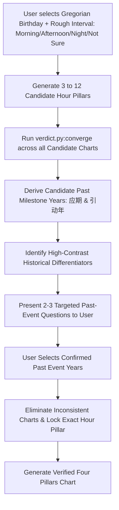

# 03. Personalization Engine Specification (签 × 命盘 × 流年)

## 1. Engine Objective

The Personalization Engine transforms a static 60 Jiazi lot interpretation into a bespoke, multi-layered reflective analysis by calculating the astrological interactions between:
1. **The Lot's Jiazi (签支)**: The specific Heavenly Stem and Earthly Branch (干支) of the drawn lot.
2. **The User's Four Pillars Natal Chart (命盘 BaZi)**: The Year, Month, Day, and Hour pillars determined by birth date, time, and true solar geographic location.
3. **The Current Annual Pillar (流年)**: The active astronomical energy of the ongoing year.

---

## 2. Core Dual-Engine Architecture

To deliver both lightweight offline responsiveness and profound paid analytical depth, the platform deploys a **Two-Tier Engine Architecture** directly synthesized from the canonical reference implementations:

```mermaid
graph TD
    subgraph Tier 1: Free Tier Mazu Nayin Engine (抽签网页_开发版)
        T1_In[Gregorian Birth Date & Hour] --> T1_Pillars[Lightweight Ephemeris: 4 Pillars]
        T1_Pillars --> T1_Nayin[Ganzhi to 30 Nayin Pairs Mapping]
        Lot_Ganzhi[Drawn Lot Ganzhi] --> Lot_Nayin[Lot Nayin Mapping]
        T1_Nayin & Lot_Nayin --> T1_Rel[Nayin Orientation Rel: 契+1 / 逆-1 / 平0]
        T1_Rel --> T1_Score[Weighted Scoring: Lot 60% + Year 20% + YMD 20%]
        T1_Score --> T1_Band[Band Verdict: 吉 >= +0.30 / 凶 <= -0.30 / 平]
    end

    subgraph Tier 2: Advanced Paid Life Book Kernel (米圖八字排盤軟件_交付版内核)
        T2_In[Birth Parameters + Location Coordinates] --> T2_Sun[True Solar Time Precision Ephemeris]
        T2_Sun --> T2_Pillars[4 Pillars + 10-Year Dayun + 80-Year Liunian]
        T2_Pillars --> T2_Layers[Multi-Layered Metaphysical Rules: rules.json & 机制归并_v2.json]
        T2_Layers --> T2_Verdict[verdict.py: converge & year_events]
        T2_Verdict --> T2_Milestones[Converged Life Milestones: 应期 & 引动年]
        T2_Verdict --> T2_Hook[Insightful Excerpt Hook: settle_nature & main_verdicts]
        T2_Verdict --> T2_LifeBook[layers_mingshu.py: 9-Section Full Life Book Report]
        T2_Verdict --> T2_Predict[Event-Triggered Future Predictive Alerts]
    end
```

---

## 3. Tier 1: Free Mazu Nayin Engine (轻量纳音排盘引擎)
*Referenced from `抽签网页_开发版/js/engine.js` & `data/engine.json`.*

1. **Four Pillars Solar Term Bounds**:
   - Year Pillar: Bound strictly by *Lichun* (立春) solar term day of year.
   - Month Pillar: Bound strictly by the 12 Monthly *Jie* (节).
   - Day Pillar: Classical Julian day modulus from 1900-01-01 anchor.
   - Hour Pillar: Late-Zi hour (23:00) transitions to next day's stem; 2-hour branch grouping.
2. **Nayin Orientation Scoring Matrix**:
   - Each Ganzhi maps to one of the 30 classical Nayin pairs (e.g. 甲子/乙丑 $\to$ 海中金).
   - The Lot's Nayin is established as the principal subject (主体).
   - Each Natal Pillar Nayin is tested against the Lot Nayin: **Harmonious (契, +1)**, **Clashing (逆, -1)**, or **Neutral (平, 0)**.
3. **Weighting Formulation**:
   $$\text{Score} = \frac{W_{\text{sign}} \times S_{\text{sign}} + W_{\text{year}} \times S_{\text{year}} + W_{\text{ymd}} \times S_{\text{ymd}}}{\sum W_{\text{active}}}$$
   - Default Weights: **Lot ($W_{\text{sign}} = 0.60$)**, **Year Pillar ($W_{\text{year}} = 0.20$)**, **Month/Day/Hour Mean ($W_{\text{ymd}} = 0.20$)**.
   - Band Evaluation:
     $$\text{Band} = \begin{cases} \text{吉 (Auspicious)}, & \text{Score} \ge +0.30 \\ \text{凶 (Guarded)}, & \text{Score} \le -0.30 \\ \text{平 (Balanced)}, & \text{otherwise} \end{cases}$$

---

## 4. Tier 2: Advanced Paid Kernel & Astrological Pipeline
*Referenced from `米圖八字排盤軟件_交付版内核` (`paipan.py`, `engine.py`, `verdict.py`, `layers_mingshu.py`).*

### 4.1 Cross-Matrix Interaction Engine
- Evaluates Day Master (日主) against Ten Gods (十神), Stem Five Combinations (天干五合), and Stem Clashes.
- Evaluates Branch relationships: Six Harmonies (六合), Three Harmonies (三合), Six Clashes (六冲), Punishments (相刑), Destructions (相破), and Harms (相穿).
- **Palace Domain Mapping (宫位事件机制)**:
  - **日支 (夫妻宫)**: Relationship harmony, marriage milestones, emotional turbulence.
  - **时支 (子女宫 / 晚运)**: Personal aspirations, children, relocations, surgeries.
  - **月支 / 年支 (父母 / 祖上宫)**: Career baseline, societal platform, family heritage.
- **Treasury Mechanics (四大库支: 辰戌丑未)**:
  - 冲开 (Clash open) $\to$ Asset unlocking, major financial breakthroughs.
  - 穿空 (Harm empty) $\to$ Capital depletion, unexpected outlays.
  - 合闭 (Combine closed) $\to$ Liquidity lockup, asset preservation.
  - 破动 (Destruction) $\to$ Investment churn, asset restructuring.

---

## 5. Birth Hour Rectification Algorithm (时辰逆推 / 考时定盘)

Over 40% of users do not remember their precise birth hour. The advanced paid kernel resolves this mathematically through past milestone convergence:



### Algorithmic Execution Steps:
1. **Candidate Hour Interval Filtering**:
   - **Morning (早)**: 卯时 (05:00–07:00), 辰时 (07:00–09:00), 巳时 (09:00–11:00).
   - **Afternoon (午)**: 午时 (11:00–13:00), 未时 (13:00–15:00), 申时 (15:00–17:00).
   - **Night (晚)**: 酉时 (17:00–19:00), 戌时 (19:00–21:00), 亥时 (21:00–23:00).
   - **Not Sure (不清楚)**: Evaluates all 12 Earthly Branches (子 to 亥).
2. **Candidate Chart Event Derivation (`verdict.py:converge()`)**:
   - For each candidate Hour Pillar $H_k$, the engine evaluates the user's historical life timeline (from age 15 to current age) against Dayun and Liunian.
   - Tracks whether high-amplitude events ($|\text{score}| \ge 0.9, \text{amp} \ge 1.2$) occurred in specific calendar years:
     - Candidate $H_1$ produces a major 夫妻宫 clash in 2018 (relationship crisis or marriage).
     - Candidate $H_2$ produces a major 子女宫/事业 relocation clash in 2019.
     - Candidate $H_3$ produces a 财库冲开 breakthrough in 2021.
3. **Differential Questionnaire Generation**:
   - The engine selects the 2–3 calendar years with the highest variance across candidate hours:
     - *Question 1*: *"Did you experience a major change in career position, job relocation, or residence around 2018 vs 2021?"*
     - *Question 2*: *"Around 2015–2016, did you undergo a significant relationship milestone or domestic transformation?"*
4. **Mathematical Convergence & Verification**:
   - User responses act as confirmation filters. The algorithm scores candidate hours; the candidate with the highest concordance is locked (*考时定盘*).

---

## 6. The Convincing Insightful Excerpt Hook & Life Book Synthesis

### 6.1 The Free Convincing Hook
- Before payment, the engine runs `verdict.py:settle_nature()` and `main_verdicts()`.
- Generates a 2–3 sentence structural summary highlighting the user's innate temperament, deep psychological dilemmas, and authentic career archetype.
- Zero generic fluff: speaks directly to specific structural tensions (e.g. *"食神制杀"*, *"印星过旺"*, *"财库逢冲"* expressed in clean, modern psychological terms).
- Demonstrates unmistakable diagnostic accuracy, providing strong organic motivation to unlock the full report.

### 6.2 Full 9-Section Life Book Report (`layers_mingshu.py`)
Upon payment, the user unlocks the full 9-section narrative report:
1. **一 命局定性 (Life Structure Character & Temperament)**: Fundamental archetype, five element balance, core tensions.
2. **二 事业与职业 (Career, Purpose & Industry Orientation)**: Optimal organizational role, leadership vs specialist path.
3. **三 财富机制 (Wealth Architecture & Treasuries)**: Income patterns, asset accumulation, 财库 dynamics.
4. **四 婚姻感情 (Partnership & Relational Timing)**: 夫妻宫 interactions, harmony factors, strategic timing.
5. **五 六亲家庭 (Family & Interpersonal Dynamics)**: Parents, lineage, children (子女宫).
6. **六 身心健康 (Vitality & Five Elements Balance)**: Energetic balance, organ systems to nurture.
7. **七 做功与厚化 (Core Action Capacities & Karmic Anchors)**: Tangible execution mechanisms and strengths.
8. **八 大运走势 (10-Year Major Luck Cycles)**: Macro-environmental phases across decades.
9. **九 流年关键窗口与应期 (Annual Windows, Major Milestones & Trigger Mechanisms)**: Converged key years (`应期`) and secondary triggers (`引动年`).

---

## 7. Event-Triggered Predictive Model & Subscription Products

### Predictive Engine Mechanics:
- The system continuously calculates the interaction between the user's natal chart and active planetary/calendar transits:
  - **Upcoming `引动年` & `应期` Alerts**: Proactive notifications 30 days before a calendar year that activates natal palaces (e.g., upcoming 2027 丁未 clashing 丑 to open the Metal treasury).
  - **Solar Term Energy Shifts (二十四节气交运)**: Seasonal guidance delivered at pivotal transitions (Lichun, Equinoxes, Solstices) mapping the active seasonal element to the user's Day Master.
  - **Monthly & Weekly Contemplative Check-ins**: Tailored reflective questions aligned with the active lunar month's stem-branch.

---

## 🧭 Planning Navigation (Relative Links)
- [00. Executive Summary](./00_EXECUTIVE_SUMMARY.md)
- [01. Product Requirements Document](./01_PRODUCT_REQUIREMENTS_DOCUMENT.md)
- [02. Ten-Step User Journey Specification](./02_TEN_STEP_USER_JOURNEY_SPEC.md)
- [03. Personalization Engine Specification](./03_PERSONALIZATION_ENGINE_SPEC.md)
- [04. Domain Mapping & Question Gate Specification](./04_DOMAIN_MAPPING_AND_QUESTION_GATE.md)
- [05. Technical Architecture & Multi-Platform Strategy](./05_TECHNICAL_ARCHITECTURE_AND_MULTI_PLATFORM.md)
- [06. Compliance, Legal & Payment Specifications](./06_COMPLIANCE_LEGAL_AND_PAYMENTS.md)
- [07. Project Roadmap & Milestones](./07_PROJECT_ROADMAP_AND_MILESTONES.md)
- [Root README](../../README.md)

