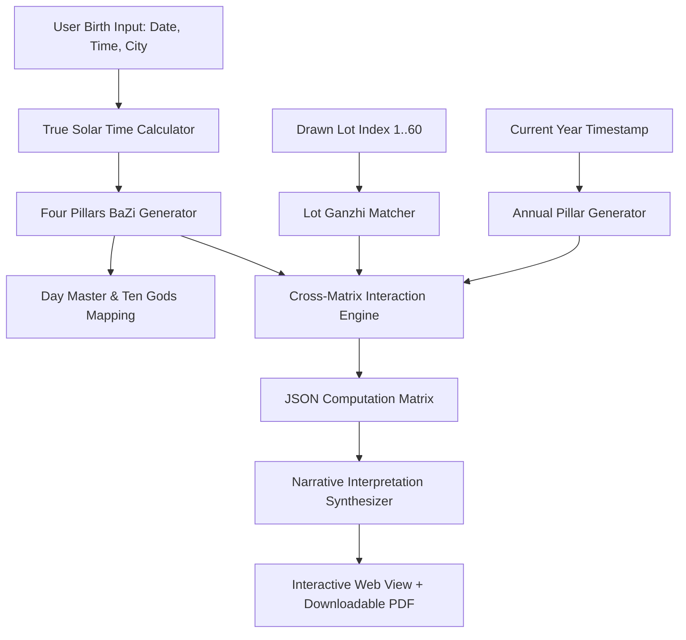

# 03. Personalization Engine Specification (签 × 命盘 × 流年)

## 1. Engine Objective

The Personalization Engine transforms a static 60 Jiazi lot interpretation into a bespoke, multi-layered reflective analysis by calculating the astrological interactions between:
1. **The Lot's Jiazi (签支)**: The specific Heavenly Stem and Earthly Branch (干支) of the drawn lot.
2. **The User's Four Pillars Natal Chart (命盘 BaZi)**: The Year, Month, Day, and Hour pillars determined by birth date, time, and true solar geographic location.
3. **The Current Annual Pillar (流年)**: The active astronomical energy of the ongoing year.

---

## 2. Core Architectural Principles
1. **Zero Black-Box Guesswork**: Every calculation is rooted in canonical Chinese Ganzhi (干支) interaction rules: Stem Combinations/Clashes (天干合化/克冲), Branch Harmonies, Clashes, Punishments, and Harms (地支六合、三合、六冲、相刑、相害).
2. **Empowerment Over Fatalism**: Output describes **energetic dynamics, points of friction, and constructive action windows** rather than claiming fixed destiny or fatalistic outcomes.
3. **Seasonal Windows, Never Rigid Dates**: Timing guidance references the five phases (五行) and four seasons / solar terms (节气), intentionally avoiding deterministic day/hour promises.

---

## 3. Mathematical & Astrological Pipeline



### 3.1 Step A: True Solar Time & Four Pillars Generation
1. **Geographic Longitude Adjustment**:
   $$\text{Solar Time} = \text{Standard Clock Time} + 4 \times (\text{Longitude}_{\text{birth}} - \text{Longitude}_{\text{standard timezone}}) + \text{Equation of Time (EoT)}$$
2. **Four Pillars Construction**:
   - **Year Pillar (年柱)**: Calculated based on the *Lichun* (立春) solar term boundary.
   - **Month Pillar (月柱)**: Calculated strictly according to the 12 Monthly Solar Terms (节气).
   - **Day Pillar (日柱)**: Classical Julian Day Number modulus calculation. The Heavenly Stem of the Day Pillar is designated as the **Day Master (日主)**, representing the conscious core of the user.
   - **Hour Pillar (时柱)**: Computed using the classical *Five Rats Seek the Hour* (五鼠遁日) formula. If the user marks "Birth Time Unknown," the Day Master is calculated and Hour Pillar interactions are gracefully omitted.

### 3.2 Step B: The Lot's Canonical Ganzhi (干支) Alignment
Each of the 60 Mazu Lots corresponds 1-to-1 with the Sixty Jiazi cycle:
- `Lot 1`: 甲子 (Jia-Zi)
- `Lot 2`: 乙丑 (Yi-Chou)
- ...
- `Lot 27`: 戊辰 (Wu-Chen)
- ...
- `Lot 60`: 癸亥 (Gui-Hai)
*(Canonical order verified: $\text{set}(\text{Ganzhi}) == \text{set}(\text{Sixty Jiazi})$).*

### 3.3 Step C: The Cross-Matrix Computation (刑冲合害与十神)

The engine evaluates how the Lot's Stem and Branch interact with each of the user's 4 Natal Pillars:

#### 1. Heavenly Stem Relationships (天干关系)
- **Stem Five Combinations (天干五合)**:
  - 甲己合 (Earth), 乙庚合 (Metal), 丙辛合 (Water), 丁壬合 (Wood), 戊癸合 (Fire).
  - *Interpretation*: Indicates alignment, harmonious partnership, external assistance, or mutual resolution.
- **Stem Clashes (天干相克)**:
  - *Interpretation*: Dynamic friction requiring conscious adjustments, negotiation, or mindful restraint.
- **Ten Gods Archetype (十神) of the Lot Stem relative to Day Master**:
  - *Direct Resource / Indirect Resource (印星)*: Learning, support, emotional shelter, patience.
  - *Direct Officer / Seven Killings (官杀)*: Leadership, discipline, career pressure, legal clarity.
  - *Friend / Rob Wealth (比劫)*: Peers, competitors, collaboration, boundary setting.
  - *Eating God / Hurting Officer (食伤)*: Expression, creativity, initiative, emotional release.
  - *Direct Wealth / Indirect Wealth (财星)*: Pragmatism, resource allocation, tangible execution.

#### 2. Earthly Branch Relationships (地支关系)
- **Branch Six Harmonies (地支六合)**: 子丑, 寅亥, 卯戌, 辰酉, 巳申, 午未. (Signals natural consensus and internal alignment).
- **Branch Three Harmonies (地支三合)**:
  - 申子辰 (Water), 亥卯未 (Wood), 寅午戌 (Fire), 巳酉丑 (Metal).
- **Branch Six Clashes (地支六冲)**:
  - 子午冲, 丑未冲, 寅申冲, 卯酉冲, 辰戌冲, 巳亥冲.
  - *Interpretation*: Structural breakthroughs, sudden departures, need for honest reinvention.
- **Branch Punishments (地支相刑)** & **Harms (地支六害)**:
  - Pinpoints internal conflicts, miscommunications, or boundary challenges in specific domains.

#### 3. Pillar Domain Mapping:
- **Interaction with Day Pillar**: Impacts personal emotional landscape and primary partnership.
- **Interaction with Month Pillar**: Impacts career focus, organizational environment, and livelihood.
- **Interaction with Year Pillar**: Impacts wider societal standing, legacy, and family lineage.
- **Interaction with Hour Pillar**: Impacts private aspirations, children, and long-term personal projects.

### 3.4 Step D: Annual Pillar (流年) Temporal Modulation
- The Lot is evaluated against the current calendar year's Ganzhi (e.g. 2026: 丙午 Bing-Wu; 2027: 丁未 Ding-Wei).
- Identifies **Resonant Seasonal Windows**:
  - E.g., If the Lot and Annual Pillar highlight Earth and Metal, the narrative identifies **Late Summer and Autumn** as optimal periods for consolidation and decisive action.

---

## 4. Structured Output Data Schema (JSON Spec)

```json
{
  "report_id": "rep_20261013_98a7c2",
  "lot_number": 27,
  "lot_ganzhi": "戊辰",
  "user_chart": {
    "day_master": "甲 (Yang Wood)",
    "four_pillars": {
      "year": "壬申",
      "month": "庚戌",
      "day": "甲子",
      "hour": "乙亥"
    }
  },
  "annual_pillar": "丙午",
  "calculated_interactions": {
    "day_master_ten_god": "偏财 (Indirect Wealth / Resourcefulness)",
    "stem_interactions": [
      {
        "target_pillar": "year",
        "type": "control",
        "description": "Lot Stem 戊 Earth controls Year Stem 壬 Water (Pragmatic structure grounds broad ideas)"
      }
    ],
    "branch_interactions": [
      {
        "target_pillar": "day",
        "type": "semi_three_harmony",
        "branches": ["辰", "子"],
        "element": "Water",
        "description": "Lot Branch 辰 combines with Day Branch 子 (Deep emotional grounding and intuitive clarity)"
      },
      {
        "target_pillar": "month",
        "type": "clash",
        "branches": ["辰", "戌"],
        "description": "Lot Branch 辰 clashes with Month Branch 戌 (Career restructuring and reassessment of priorities)"
      }
    ],
    "seasonal_resonance": {
      "favourable_seasons": ["Late Summer", "Winter"],
      "strategic_focus": "Consolidation of assets and internal realignment before external launch"
    }
  },
  "compliance": {
    "disclaimer_types": ["cultural_heritage", "reflective_guidance", "non_deterministic"],
    "version": "1.0"
  }
}
```

---

## 5. Narrative Synthesis & Guardrails

The engine takes the deterministic JSON matrix and generates a human-centered, poetic, and actionable report.

### Guardrails Enforced:
1. **Forbidden Lexicon**: Words like *"guaranteed to happen"*, *"bad luck"*, *"cursed"*, *"fatal disease"*, *"winning lottery"* are strictly blacklisted.
2. **Format Sections**:
   - **Executive Archetype**: What this lot represents for your Day Master.
   - **The Friction & Harmony Matrix**: Where your chart meets the lot (Career vs Internal Life).
   - **The Seasonal Rhythm**: When during the year the energy is most supportive.
   - **Action Prompts**: Three reflective journaling questions for practical life decision-making.

---

## 🧭 Planning Navigation (Relative Links)
- [00. Executive Summary](./00_EXECUTIVE_SUMMARY.md)
- [01. Product Requirements Document](./01_PRODUCT_REQUIREMENTS_DOCUMENT.md)
- [02. Ten-Step User Journey Specification](./02_TEN_STEP_USER_JOURNEY_SPEC.md)
- [03. Personalization Engine Specification](./03_PERSONALIZATION_ENGINE_SPEC.md)
- [04. Domain Mapping & Question Gate Specification](./04_DOMAIN_MAPPING_AND_QUESTION_GATE.md)
- [05. Technical Architecture & Multi-Platform Strategy](./05_TECHNICAL_ARCHITECTURE_AND_MULTI_PLATFORM.md)
- [06. Compliance, Legal & Payment Specifications](./06_COMPLIANCE_LEGAL_AND_PAYMENTS.md)
- [07. Project Roadmap & Milestones](./07_PROJECT_ROADMAP_AND_MILESTONES.md)
- [Root README](../../README.md)

