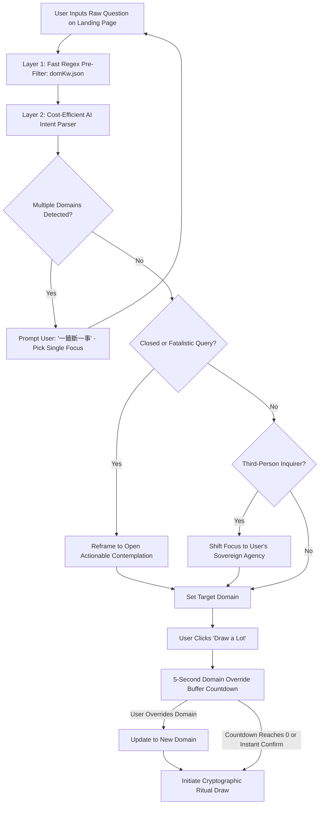

# 04. Domain Mapping & Question Gate Specification

## 1. The Category Gap & Mapping Architecture

### 1.1 The Problem Statement
In traditional temple Mazu divination systems, there are up to **29 classical inquiry categories** (e.g., 功名, 作事, 求財, 經商, 婚姻, 六甲, 求兒, 治病, 官事, 家事, 家運, 出外, 移居, 築室, 歲君, 月令, 討海, 行舟, 耕作, 六畜, 魚苗, 作塭, 失物, 尋人, 來人, 遠信, 凡事, etc.).

However, modern English localization layers typically present a cleaner set of intuitive life domains. Existing datasets may have gaps where categories like 經商 (Business), 求兒 (Conception/Fertility), 官事 (Legal Disputes), 尋人 (Finding Persons), 失物 (Lost Property), 移居 (Relocation/Settlement), and 凡事 (General Matters) lack isolated English slots.

### 1.2 The Two-Pronged Resolution Strategy
1. **Canonical Mapping with Explicit Annotation (映射 + 标注)**:
   - For all 29 traditional temple categories, each is systematically mapped to one of the 11–13 English domain slots (`category_slots`).
   - When displayed, the UI explicitly notes the traditional root (e.g., *"Showing guidance for Business & Commerce — derived from traditional temple entry 經商"*).
2. **Supplemental Content Expansion**:
   - For slots requiring unique legal or ethical boundaries (such as `conception` and `legal`), dedicated guidance lines and compliance flags are attached directly.

---

## 2. Full 29-Category to English Slot Mapping Matrix

## 2. Canonical 13-Domain Taxonomy Matrix (对齐 `抽签网页_开发版`)

The platform's 13 canonical domains are directly aligned with `抽签网页_开发版/data/domains.json` and `domKw.json`:

| # | Domain Key | Chinese Label (中文类目) | English Display Name | Canonical Temple Roots (解曰对应) | Tier | Regulatory / Ethical Flags | Regex Keywords Anchor (`domKw.json`) |
| :- | :--- | :--- | :--- | :--- | :-: | :--- | :--- |
| 1 | `general` | 综合运势 | General / Overall | **凡事** | 1 | — | 运势、全面、以后、指引、近况 |
| 2 | `relationships` | 感情婚姻 | Love & Partnership | **婚姻** | 1 | — | 婚姻、感情、对象、男友、女友、恋爱、结婚、离婚、桃花、伴侣、相亲 |
| 3 | `career` | 事业与学业 | Career & Study | **功名**、**作事** | 1 | — | 事业、工作、升职、晋升、考试、学业、考研、考公、面试、跳槽、职位、录取 |
| 4 | `money` | 财运与生意 | Money & Business | **求財**、**經商** | 1 | `not_financial_advice` | 财、钱、收入、生意、投资、买卖、赚、亏、债、贷、回款、客户、订单、薪水 |
| 5 | `health` | 健康身心 | Health & Vitality | **治病** | 1 | `not_medical_advice` | 健康、身体、病、症、疼、痛、失眠、睡眠、体检、康复、手术、吃药、就医 |
| 6 | `family_home` | 家庭家宅 | Home & Family | **家運**、**家事**、**築室**、**墳墓** | 1 | — | 家宅、家庭、房子、房产、宅、装修、家人、父母、爸、妈、子女、亲戚、老人 |
| 7 | `travel_moving` | 出行搬迁 | Travel & Moving | **出外**、**移居** | 2 | — | 出行、搬家、搬迁、出差、旅游、旅行、移居、迁居、落户、外地、回乡 |
| 8 | `sea_and_voyage` | 出海舟行 | Sea & Voyage (Mazu Heritage) | **討海**、**行舟** | 2 | — | 出海、航运、船、海运、外贸、跨境、港口、远洋、赴海 |
| 9 | `the_absent_one` | 寻人失物音信 | Lost Items & Missing News | **失物**、**尋人**、**來人**、**遠信** | 2 | `third_person_to_self` | 失物、丢失、丢、找不到、寻人、音信、联系不上、远信、下落、失联 |
| 10 | `legal` | 官事纠纷 | Legal Matters | **官事** | 2 | `not_legal_advice` | 官司、诉讼、纠纷、法律、开庭、仲裁、打官司、合同、上诉、案 |
| 11 | `conception` | 求子 | Fertility & Children | **求兒**、**六甲** | 2 | `no_medical_outcome` | 求子、怀孕、生育、生孩、备孕、试管、胎、子嗣 |
| 12 | `timing` | 时机流年 | This Year's Timing | **歲君**、**月令** | 2 | `season_only_no_date` | 流年、今年、什么时候、时机、运程、哪年、本命年 |
| 13 | `livelihood_and_seasons` | 农渔生计 | Livelihood & Agriculture | **耕作**、**求雨**、**六畜**、**作塭**、**魚苗** | 2 | — | 农作、渔获、养殖、种植、畜牧、收成、鱼苗、捕鱼、种地 |

---

## 3. The Question Gate (问法治理闸门) Deep Architecture

The Question Gate operates as an intelligent pre-draw validation, classification, and transformation barrier.



### 3.1 Pre-Flight Rules

#### Rule 1: One Matter Per Lot ("一籤斷一事")
- **Problem**: Users frequently ask compound queries: *"Can I get promoted this quarter and will my boyfriend propose?"* (Combines Career and Relationships).
- **Gate Intervention**:
  - Detects compound intent across distinct domains.
  - Halts the draw and prompts:
    > *"Traditional wisdom teaches that **one lot answers one matter (一籤斷一事)**. Your inquiry touches on both **Career & Study** and **Love & Partnership**. Please select which matter you would like to focus on first."*
  - Provides two prominent buttons allowing the user to select one domain with a single click.

#### Rule 2: Reframe Closed & Fatalistic Questions (封闭式问句当场改写)
- **Problem**: Users ask binary yes/no fortune questions: *"Will I pass my bar exam?"* or *"Will I get rich this year?"*
- **Gate Intervention**:
  - Retains core intent while opening into reflective wisdom:
    - *"Will I pass my bar exam?"* $\rightarrow$ *"What state of mind, discipline, and right effort are mine to cultivate to approach this examination?"*
    - *"Will I get rich this year?"* $\rightarrow$ *"How can I cultivate financial prudence and recognize sound opportunities in this season?"*

#### Rule 3: Third-Person Shift (第三人转自我视角)
- **Problem**: Inquiries about other people's sovereign intentions: *"Will my boss fire me?"* or *"Does my partner still love me?"*
- **Gate Intervention**:
  - Reframes query toward the seeker's own actions and perspective:
    - *"Will my boss fire me?"* $\rightarrow$ *"How can I bring clarity, professional excellence, and firm boundaries to my current work environment?"*

---

### 3.2 The 5-Second Domain Override Buffer (5秒确认与调选窗口)

To balance automatic AI convenience with user sovereignty, the system introduces a **5-second confirmation buffer**:
1. When the user clicks the **[ Draw a Lot / 诚心求签 ]** button, the screen displays a focused confirmation card:
   > **Inquiring On**: `[ 💼 Career & Purpose / 事业与学业 ]`  
   > *"Drawing in 5 seconds... Not what you intended? Click any category below to switch."*
2. **Visual Countdown & Controls**:
   - A smooth 5-second circular progress indicator counts down `5... 4... 3... 2... 1...`.
   - The user can click any of the other 12 domain badges in the grid to immediately change the target domain.
   - The user can click `[ Draw Now / 立即起签 ]` to skip the timer and draw immediately.
3. Once the 5-second countdown elapses or the user confirms, the cryptographic bamboo shake animation begins automatically.

---

## 4. Cost-Efficient AI Engine Architecture & Token Pluggability

### 4.1 Tiered Processing Pipeline
1. **Tier 1: Ultra-Fast Client Regex Pre-Classifier (< 5ms)**:
   - Matches keywords directly from `domKw.json` (e.g. `婚姻|感情|对象`, `事业|工作|升职`, `财|钱|生意`).
   - If a single clear domain is matched without ambiguity or fatalistic markers, sets the default domain instantly without server API cost.
2. **Tier 2: Cost-Efficient LLM Routing (< 400ms)**:
   - If the query contains complex syntax, multi-domain conjunctions (*"还有"*, *"同时"*, *"and also"*), or fatalistic phrasing (*"会不会"*, *"能不能"*), the system calls a cost-efficient LLM endpoint.
   - **Supported API Providers**:
     - **FreeLLMAPI / DeepSeek Chat / OpenAI-Compatible Mini Models**: Highly cost-effective (sub-$0.0002 per inquiry).
     - Pluggable API token configuration via environment variables (`AI_API_ENDPOINT`, `AI_API_KEY`, `AI_MODEL_NAME`).
   - **Structured JSON Output Schema**:
     ```json
     {
       "primary_domain": "career",
       "is_compound": false,
       "detected_domains": ["career"],
       "needs_reframe": true,
       "reframed_question": "What professional focus and preparation are mine to cultivate in this season?",
       "reframe_reason": "Reframing from fatalistic prediction to actionable wisdom."
     }
     ```
3. **Graceful Fallback**:
   - If the AI API is unreachable or times out (> 1.5s), the system defaults smoothly to Tier 1 regex or the fallback domain `general` (综合运势 / 凡事), ensuring the user is never blocked.

---

## 🧭 Planning Navigation (Relative Links)
- [00. Executive Summary](./00_EXECUTIVE_SUMMARY.md)
- [01. Product Requirements Document](./01_PRODUCT_REQUIREMENTS_DOCUMENT.md)
- [02. Ten-Step User Journey Specification](./02_TEN_STEP_USER_JOURNEY_SPEC.md)
- [03. Personalization Engine Specification](./03_PERSONALIZATION_ENGINE_SPEC.md)
- [04. Domain Mapping & Question Gate Specification](./04_DOMAIN_MAPPING_AND_QUESTION_GATE.md)
- [05. Technical Architecture & Multi-Platform Strategy](./05_TECHNICAL_ARCHITECTURE_AND_MULTI_PLATFORM.md)
- [06. Compliance, Legal & Payment Specifications](./06_COMPLIANCE_LEGAL_AND_PAYMENTS.md)
- [07. Project Roadmap & Milestones](./07_PROJECT_ROADMAP_AND_MILESTONES.md)
- [Root README](../../README.md)

