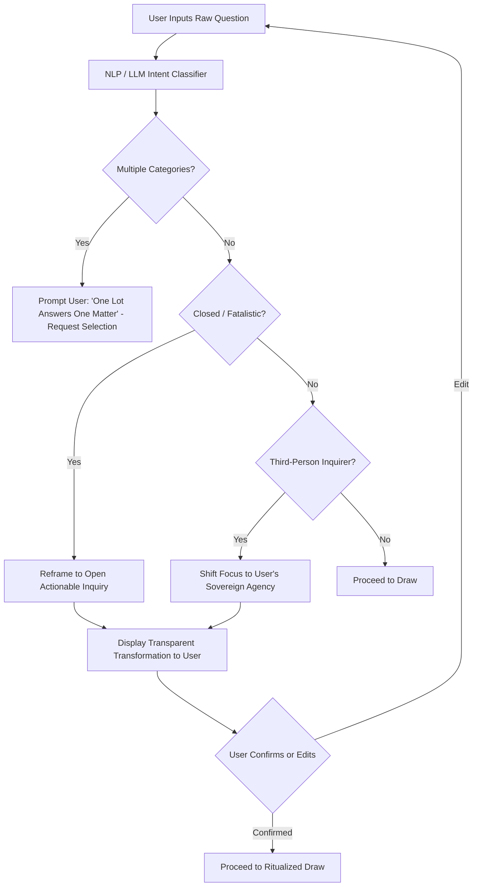

# 04. Domain Mapping & Question Gate Specification

## 1. The Category Gap & Mapping Architecture

### 1.1 The Problem Statement
In traditional temple Mazu divination systems, there are up to **29 classical inquiry categories** (e.g., 功名, 作事, 求財, 經商, 婚姻, 六甲, 求兒, 治病, 官事, 家事, 家運, 出外, 移居, 築室, 歲君, 月令, 討海, 行舟, 耕作, 六畜, 魚苗, 作塭, 失物, 尋人, 來人, 遠信, 凡事, etc.).

However, modern English localization layers typically present a cleaner set of intuitive life domains. Existing datasets may have gaps where categories like 經商 (Business), 求兒 (Conception/Fertility), 官事 (Legal Disputes), 尋人 (Finding Persons), 失物 (Lost Property), 移居 (Relocation/Settlement), and 凡事 (General Matters) lack isolated English slots.

### 1.2 The Two-Pronged Resolution Strategy
1. **Canonical Mapping with Explicit Annotation (映射 + 标注)**:
   - For all 29 traditional temple categories, each is systematically mapped to one of the 11–13 English domain slots (`category_slots`).
   - When displayed, the UI explicitly notes the traditional root (e.g., *"Showing guidance for Business & Commerce — derived from traditional temple entry 經商"*).
2. **Supplemental Content Expansion**:
   - For slots requiring unique legal or ethical boundaries (such as `conception` and `legal`), dedicated guidance lines and compliance flags are attached directly.

---

## 2. Full 29-Category to English Slot Mapping Matrix

The system operationalizes the canonical dataset (`定本/类目映射_29类目_to_slots.csv`) as follows:

| # | English Slot ID | Modern Display Name | Mapped Classical Categories (传统类目) | Regulatory & Ethical Flag | Mapping Annotation Note |
| :--- | :--- | :--- | :--- | :--- | :--- |
| 1 | `career` | Career & Ambition | **功名** (Public Honors), **作事** (General Undertakings) | — | Covers employment, promotions, and academic exams. |
| 2 | `money` | Wealth & Finance | **求財** (Seeking Wealth) | `not_financial_advice` | Emphasizes diligence, risk aversion, and stewardship. |
| 3 | `business` | Business & Commerce | **經商** (Trade & Enterprise) | `not_financial_advice` | Distinguishes entrepreneurial ventures from wage work. |
| 4 | `relationships`| Love & Partnership | **婚姻** (Matrimony & Union) | — | Centers interpersonal harmony and patience. |
| 5 | `health` | Health & Vitality | **治病** (Curing Illness) | `not_medical_advice` | Strictly focuses on psychological fortitude and consulting qualified practitioners. |
| 6 | `legal` | Legal & Disputes | **官事** (Official / Court Matters) | `not_legal_advice` | Counsel on mediation, integrity, and non-aggression. |
| 7 | `family_home` | Family & Household | **家事** (Domestic Affairs), **家運** (Household Fortunes) | — | Covers harmony among relatives and home stability. |
| 8 | `conception` | Conception & Children | **求兒** (Seeking Offspring), **六甲** (Pregnancy & Childbirth) | `no_medical_outcome_implied` | Strictly emotional encouragement; forbids predicting gender or health outcomes. |
| 9 | `travel_moving`| Relocation & Travel | **出外** (Going Abroad), **移居** (Relocation), **築室** (Building Home) | — | Guidance on environmental shifts and physical moves. |
| 10 | `timing` | Seasonal Timing | **歲君** (Year Sovereign), **月令** (Monthly Order) | `seasonal_windows_only` | Discloses seasonal windows; explicitly prohibits calendar dates. |
| 11 | `sea_and_voyage`| Sea & Navigation | **討海** (Seafaring / Fishing), **行舟** (Voyaging by Boat) | — | Dedicated Mazu heritage slot honoring seafaring culture. |
| 12 | `livelihood_and_seasons`| Agriculture & Craft | **耕作** (Farming), **六畜** (Livestock), **魚苗** (Fish Hatcheries), **作塭** (Aquaculture) | — | Preserves traditional agricultural and artisanal roots. |
| 13 | `loss_and_recovery`| Lost Items & News | **失物** (Lost Items), **尋人** (Searching for Persons), **來人** (Expected Guests), **遠信** (Letters from Afar) | `self_agency_reframing` | Reframes third-person inquiry back into the user's focus. |
| 14 | `general` | General Guidance | **凡事** (General Life Matters) | — | Fallback umbrella when no single domain dominates. |

---

## 3. The Question Gate (问法治理闸门) Deep Architecture

The Question Gate operates as an intelligent pre-draw validation and transformation barrier.



### 3.1 Pre-Flight Rules

#### Rule 1: One Matter Per Lot (一问一事)
- **Problem**: Users frequently ask compound questions: *"Should I quit my job and move to London with my partner?"* (Combines Career, Travel, and Relationship).
- **Gate Intervention**:
  - Detects multi-domain intent via classifier.
  - Returns a clarification prompt:
    > *"Traditional wisdom teaches that **one lot answers one matter**. Your contemplation touches on both Career and Relocation. Which aspect would you like to bring before the lot first?"*

#### Rule 2: Reframe Closed & Fatalistic Questions (封闭式当场改写)
- **Problem**: Users ask binary yes/no fortune questions: *"Will I pass my bar exam?"* or *"Will my ex come back?"*
- **Gate Intervention**:
  - Retains the core intent while opening the question to wisdom and actionable reflection:
    - *"Will I pass my bar exam?"* $\rightarrow$ *"What state of mind and discipline must I cultivate to approach this examination with excellence?"*
    - *"Will my ex come back?"* $\rightarrow$ *"What does this relationship teach me about my own healing and personal growth at this time?"*

#### Rule 3: Third-Person Shift (第三人转自我视角)
- **Problem**: Users ask about the hidden intentions or actions of other people: *"Does my brother intend to sell our family estate?"* or *"Will my colleague get fired?"*
- **Gate Intervention**:
  - Chinese temple lots reflect the querent's own posture, not espionage on sovereign third parties.
  - Transformation:
    - *"Does my brother intend to sell our family estate?"* $\rightarrow$ *"How can I communicate with clarity and protect family harmony regarding our shared assets?"*

### 3.2 Transparent User Disclosure
The gate **never** rewrites in secret. The UI renders the transformation card:

```
┌─────────────────────────────────────────────────────────────────────────────┐
│ ✦ QUESTION GATE · REFINING YOUR INQUIRY                                     │
├─────────────────────────────────────────────────────────────────────────────┤
│ Your Original Question:                                                     │
│ "Will I get the promotion next month?"                                       │
│                                                                             │
│ Reframed Contemplation:                                                     │
│ "What leadership qualities and professional focus are mine to cultivate in   │
│  this season?"                                                              │
│                                                                             │
│ Why We Reframe:                                                             │
│ Traditional oracle poetry provides reflective mirror-guidance for your own  │
│ actions rather than calendar-date predictions.                              │
│                                                                             │
│ [ Accept Reframed Contemplation & Draw ]       [ Edit Original Question ]   │
└─────────────────────────────────────────────────────────────────────────────┘
```

---

## 4. NLP / LLM Implementation Strategy

### 4.1 Latency & Cost Optimization
1. **Tier 1: Fast Regex / Heuristic Parser (Client-Side / < 5ms)**:
   - Identifies typical interrogative markers (*"Will I"*, *"Is he"*, *"When will"*, compound conjunctions *"and also"*).
2. **Tier 2: Lightweight Classifier API (< 300ms)**:
   - Uses a structured prompt with few-shot examples or fine-tuned compact model to output:
     - `primary_category_slot`: (e.g. `career`)
     - `is_compound`: (boolean)
     - `detected_categories`: array of slots
     - `needs_reframe`: (boolean)
     - `reframed_question`: string
     - `reframe_reason`: string
3. **Graceful Fallback**: If network or AI service times out, fallback to user-selected domain from the Step 2 picker without blocking the draw.

---

## 🧭 Planning Navigation (Relative Links)
- [00. Executive Summary](./00_EXECUTIVE_SUMMARY.md)
- [01. Product Requirements Document](./01_PRODUCT_REQUIREMENTS_DOCUMENT.md)
- [02. Ten-Step User Journey Specification](./02_TEN_STEP_USER_JOURNEY_SPEC.md)
- [03. Personalization Engine Specification](./03_PERSONALIZATION_ENGINE_SPEC.md)
- [04. Domain Mapping & Question Gate Specification](./04_DOMAIN_MAPPING_AND_QUESTION_GATE.md)
- [05. Technical Architecture & Multi-Platform Strategy](./05_TECHNICAL_ARCHITECTURE_AND_MULTI_PLATFORM.md)
- [06. Compliance, Legal & Payment Specifications](./06_COMPLIANCE_LEGAL_AND_PAYMENTS.md)
- [07. Project Roadmap & Milestones](./07_PROJECT_ROADMAP_AND_MILESTONES.md)
- [Root README](../../README.md)

