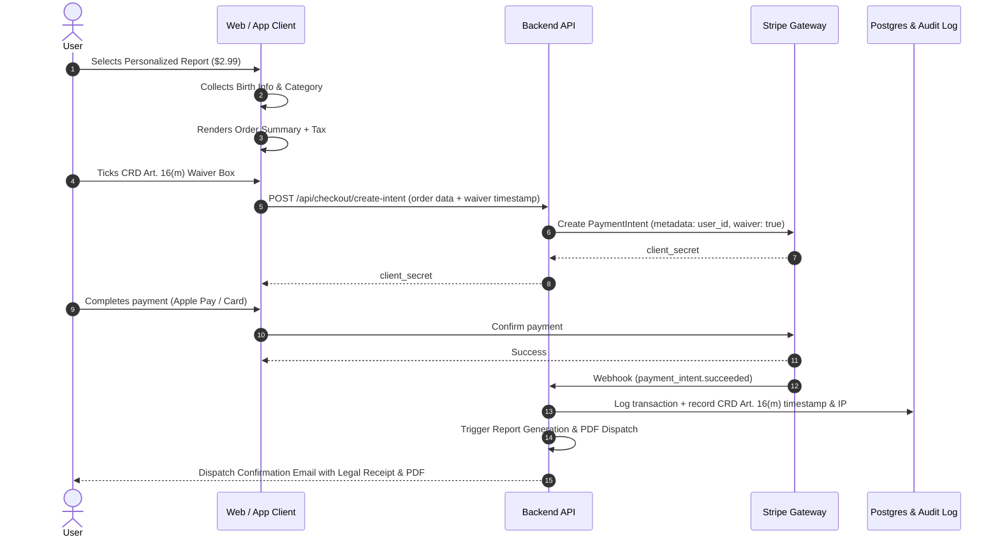

# 06. Compliance, Legal & Payment Specifications

## 1. Compliance Strategy & Legal Positioning

To operate smoothly across global markets (including the United States, European Union, and East Asia), the platform implements an airtight compliance and ethical framework based on **Reflective Cultural Guidance & Philological Heritage**.

### 1.1 The Legal Shield: Entertainment & Reflective Philosophy
In multiple legal jurisdictions (notably several US state laws governing fortune-telling and European consumer protection directives), commercial claims of "foreseeing the future" can trigger strict licensing or deceptive trade regulations.

By explicitly and consistently framing the service as:
> *"Cultural heritage exploration, philological reflection, and personal introspection — not a prediction of factual events or future outcomes."*

the platform legally situates itself within the protected domain of **cultural education, reflective self-inquiry, and entertainment**.

---

## 2. Regulatory Category Disclaimers (Automated Attachment)

Disclaimers are automatically bound to specific inquiry domains in both the Free and Paid layers. They are rendered visually distinct from the poetic interpretation:

| Domain Slot | Trigger Category | Regulatory Disclaimer Copy (Exact Required Text) | Placement |
| :--- | :--- | :--- | :--- |
| `health` | 治病 | **Notice on Health Inquiries**: *"This reading reflects classical poetic metaphors for vitality and emotional endurance. It is strictly not medical advice. For physical or mental health diagnoses, always consult a licensed medical professional."* | Directly below the Guidance Line & on PDF Report |
| `money` / `business` | 求財 / 經商 | **Notice on Financial Inquiries**: *"This reading provides traditional contemplative counsel on prudence and perseverance. It is strictly not financial, investment, or legal advice. Consult certified financial advisors for monetary decisions."* | Directly below the Guidance Line & on PDF Report |
| `legal` | 官事 | **Notice on Legal Inquiries**: *"This interpretation offers traditional wisdom regarding ethical integrity and non-aggression. It does not constitute legal counsel or judicial outcome forecasting. Consult licensed legal counsel for disputes."* | Directly below the Guidance Line & on PDF Report |
| `conception` | 求兒 / 六甲 | **Notice on Fertility & Childbearing**: *"This passage offers poetic and spiritual encouragement. It does not provide medical prognostications regarding fertility, pregnancy health, or fetal characteristics."* | Directly below the Guidance Line & on PDF Report |
| `timing` | 歲君 / 月令 | **Notice on Temporal Guidance**: *"Temporal markers describe seasonal rhythms and astronomical energetic cycles. This platform does not predict specific calendar dates, hours, or deterministic milestones."* | Boundaries Card & Report Header |

---

## 3. EU Consumer Rights Directive (CRD Art. 16(m)) Digital Content Compliance

Under the European Union Directive on Consumer Rights (2011/83/EU, amended by Directive (EU) 2019/2161), consumers possess a 14-day statutory right of withdrawal for online purchases. However, for digital content delivered immediately, this right may be waived provided strict procedural safeguards are met.

### 3.1 Checkout Requirements for Instant Reports ($2.99 / $19.99)
At the checkout screen, before the user clicks *"Pay & Generate Report"*, the following three requirements **must** be satisfied:
1. **Clear Itemized Pricing**:
   - Order Summary showing item name (*"Personalized Lot Report - Lot #X for [Name]"*).
   - Total price clearly showing applicable local VAT / Sales Tax.
2. **Mandatory Unchecked Consent Box (Art. 16(m) Waiver)**:
   - A non-pre-ticked checkbox containing the exact statutory language:
     > `[ ] I hereby consent to immediate performance of this contract and acknowledge that as soon as digital generation of my personalized report commences, I lose my statutory 14-day right of withdrawal.`
   - Payment cannot proceed until this checkbox is explicitly ticked by the user.
3. **Durable Medium Confirmation (Audit Trail Email)**:
   - Upon successful payment, an automated transactional email receipt is dispatched containing:
     - Date and timestamp of purchase.
     - Confirmation of the consumer's express prior consent and acknowledgement of the loss of withdrawal rights.
     - PDF copy or download link of the delivered report.
     - Digital receipt stored in the database for audit verification.

---

## 4. Subscription & Auto-Renewal Governance (Leg 3)

For recurring membership options ($9.99 – $11.99/mo), the checkout and account architecture strictly follows US FTC and EU auto-renewal directives:

### 4.1 Subscription Purchase Flow
1. **Separate Opt-In**: The recurring billing terms must be listed in a separate checkbox or prominent high-contrast disclosure box directly adjacent to the purchase button.
2. **Explicit Terms Stated**:
   - Billing frequency (e.g. *"Billed monthly at $11.99/month until cancelled"*).
   - Next billing date.
   - Immediate notification of rate changes.
3. **One-Click Self-Service Cancellation**:
   - Users can cancel their subscription at any time within their Account Settings with a single click (*"Cancel Subscription"*).
   - No forced telephone calls, hidden cancellation links, or deceptive retention loops (dark patterns).
   - Access remains active until the end of the prepaid billing period.

---

## 5. Stripe & Payment Processing Pipeline

---

## 6. Terms of Service & Privacy Policy Key Clauses

1. **Age Verification**: Service restricted to users 18 years of age or older (or local age of majority).
2. **No Guarantee of Specific Results**: Explicit disclaimer that readings are interpretative frameworks for personal reflection and do not guarantee life outcomes, health recoveries, financial windfalls, or relational outcomes.
3. **Intellectual Property**: Classical Chinese texts are in the public domain; however, the unrhymed English translations, editorial commentaries, dual-cluster keyword frameworks, Question Gate algorithms, and graphic representations are protected proprietary assets.

---

## 🧭 Planning Navigation (Relative Links)
- [00. Executive Summary](./00_EXECUTIVE_SUMMARY.md)
- [01. Product Requirements Document](./01_PRODUCT_REQUIREMENTS_DOCUMENT.md)
- [02. Ten-Step User Journey Specification](./02_TEN_STEP_USER_JOURNEY_SPEC.md)
- [03. Personalization Engine Specification](./03_PERSONALIZATION_ENGINE_SPEC.md)
- [04. Domain Mapping & Question Gate Specification](./04_DOMAIN_MAPPING_AND_QUESTION_GATE.md)
- [05. Technical Architecture & Multi-Platform Strategy](./05_TECHNICAL_ARCHITECTURE_AND_MULTI_PLATFORM.md)
- [06. Compliance, Legal & Payment Specifications](./06_COMPLIANCE_LEGAL_AND_PAYMENTS.md)
- [07. Project Roadmap & Milestones](./07_PROJECT_ROADMAP_AND_MILESTONES.md)
- [Root README](../../README.md)

