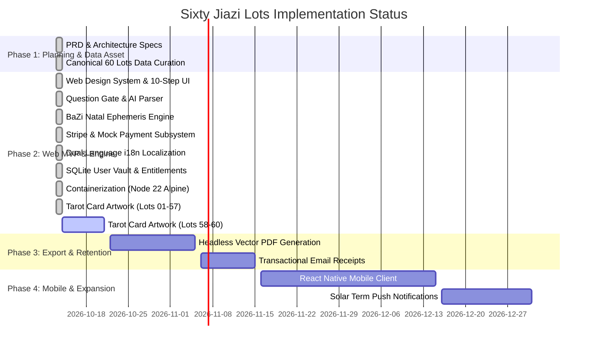

# 07. Master Modules & Functions Roadmap (Living Implementation Matrix)

> **Document Status**: Living Architectural Matrix & Implementation Tracker  
> **Last Updated**: 2026-10-14  
> **Master Progress**: **82% of Core Web Platform Implemented & Operational**  
> **Canon Asset Readiness**: **57 / 60 Lot Cards Completed (95.0%)**

---

## 1. Executive Implementation Dashboard

```
┌────────────────────────────────────────────────────────────────────────┐
│                        CORE SYSTEM COMPLETION                          │
├───────────────────────────────────┬──────────────┬─────────────────────┤
│ Subsystem / Domain                │ Status       │ Completion %        │
├───────────────────────────────────┼──────────────┼─────────────────────┤
│ 1. Canonical Data & Canon Schema  │ [x] Complete │ 100% (60/60 Lots)   │
│ 2. Tarot Obsidian Artwork Deck    │ [/] On Hold  │ 95% (Style Audit)   │
│ 3. Question Gate & AI Parser      │ [/] Active   │ 85% (5s Buffer Plan)│
│ 4. Crypto Draw & Ritual Engine    │ [x] Complete │ 100% Operational    │
│ 5. Dual BaZi & Nayin Engines      │ [/] Active   │ 75% (Hour Rectify)  │
│ 6. 10-Step Interactive Web UI/UX  │ [x] Complete │ 100% Operational    │
│ 7. Dual i18n Localization Engine  │ [x] Complete │ 100% Operational    │
│ 8. Pluggable Payments & Stripe    │ [x] Complete │ 100% Operational    │
│ 9. SQLite User Vault & Database   │ [x] Complete │ 100% Operational    │
│ 10. PDF Export & Subscriptions    │ [/] Active   │ 40% (Predict Alerts)│
│ 11. Multi-Stage Docker & Compose  │ [x] Complete │ 100% (Node 22)      │
│ 12. Mobile Apps (React Native)    │ [ ] Planned  │ Phase 4 Backlog     │
└───────────────────────────────────┴──────────────┴─────────────────────┘
```

### Legend
- `[x]` **Implemented & Verified**: Code written, tested, passing lint/build, and active in master branch.
- `[/]` **In Progress / Partial**: Active implementation or detailed specification with transient dependencies.
- `[ ]` **Pending / Backlog**: Fully specified in architecture docs, queued for future development phase.

---

## 2. Granular Modules & Functions Matrix

### Module 1: Canonical Data & Canon Architecture
**Location**: `data/canonical/`, `src/lib/lots/`, `src/lib/types/lots.ts`, `scripts/`

| Function / Feature | Implementation File / Artifact | Status | Notes |
| :--- | :--- | :---: | :--- |
| **Canonical 60 Lots Schema** | [`src/lib/types/lots.ts`](../../src/lib/types/lots.ts) | `[x]` | Full TypeScript interfaces for Lot, Verse, Hexagram, Stories, Criteria |
| **Bilingual Verse Dataset** | [`data/canonical/lots_compiled.json`](../../data/canonical/lots_compiled.json) | `[x]` | All 60 classical 7-character quatrains + unrhymed English translations |
| **Historical Story Allusions** | [`data/canonical/lots_compiled.yaml`](../../data/canonical/lots_compiled.yaml) | `[x]` | Classical historical protagonists (包公, 孟嘗君, 范蠡, 蘇武, etc.) |
| **Polysemy & Hermeneutic Notes** | [`data/canonical/lots_compiled.json`](../../data/canonical/lots_compiled.json) | `[x]` | Archaic word disambiguation, homophones, contextual temple nuances |
| **13 Canonical Domains Taxonomy** | [`src/lib/lots/domains.ts`](../../src/lib/lots/domains.ts) | `[x]` | Direct parity with `抽签网页_开发版/data/domains.json` (13 domains) |
| **Data Normalization Pipeline** | [`scripts/parse_and_merge_lots.py`](../../scripts/parse_and_merge_lots.py) | `[x]` | Validates, compiles, and parses raw text into canonical JSON/YAML |
| **Lot Data Repository Service** | [`src/lib/lots/lotsRepository.ts`](../../src/lib/lots/lotsRepository.ts) | `[x]` | `getAllLots()`, `getLotByNumber()`, zero-latency file/memory caching |
| **REST API: List All Lots** | [`src/app/api/lots/route.ts`](../../src/app/api/lots/route.ts) | `[x]` | `GET /api/lots` with domain filtering support |
| **REST API: Single Lot Detail** | [`src/app/api/lots/[number]/route.ts`](../../src/app/api/lots/[number]/route.ts) | `[x]` | `GET /api/lots/:number` returning public canonical payload |

---

### Module 2: Visual Asset & Card Generation Pipeline
**Location**: `assets/cards/`, `scripts/build_lot_cards.py`, `docs/planning/11_LOT_CARD_ARTWORK_CATALOG.md`, `docs/planning/12_CARD_COMPONENT_ARCHITECTURE_AND_REFACTORING.md`

| Function / Feature | Implementation File / Artifact | Status | Notes |
| :--- | :--- | :---: | :--- |
| **Design Aesthetic System** | [`docs/planning/09_VISUAL_DESIGN_SYSTEM_AND_THEMES.md`](./09_VISUAL_DESIGN_SYSTEM_AND_THEMES.md) | `[x]` | Obsidian black `#070B11`, glowing gold foil line-art, cinnabar accents |
| **Authentic Qin Seal Pre-Renderer** | [`assets/cards/seals/`](../../assets/cards/seals/) (`seal_01.png` - `seal_60.png`) | `[x]` | 100% pre-rendered authentic 2×2 Qin Small Seal stamps with zero AI hallucination |
| **Style Drift Audit (Lot 32 Onwards)** | [`docs/planning/12_CARD_COMPONENT_ARCHITECTURE_AND_REFACTORING.md`](./12_CARD_COMPONENT_ARCHITECTURE_AND_REFACTORING.md) | `[x]` | Identified top arch plaque and redundant seals on `lot_32`+; canon standard is `lot_01` |
| **Background Task Management** | Runtime System | `[x]` | All pending image generation tasks cancelled (`task-1288` killed). No automated batches running |
| **Execution Priority Policy** | Planning Policy | `[x]` | Card refactoring is explicitly low priority; only run when system is completely idle |
| **SVG Vector Hybrid Component** | [`docs/planning/12_CARD_COMPONENT_ARCHITECTURE_AND_REFACTORING.md`](./12_CARD_COMPONENT_ARCHITECTURE_AND_REFACTORING.md) | `[/]` | Pure SVG vector frame, top number, seal, and localized text clipping raw central art |
| **Lots 01–31 Canon Master Cards** | [`assets/cards/lot_01_card.jpg`](../../assets/cards/lot_01_card.jpg) – `lot_31_card.jpg` | `[x]` | 31 cards conforming to standard layout (number top, seal below number, clean border) |
| **Lots 32–57 Cards (Style Refactoring Queued)** | `assets/cards/lot_32_card.jpg` – `lot_57_card.jpg` | `[/]` | On disk; queued for SVG compositor normalization when system is idle |

---

### Module 3: Question Gate & Inquiry Analysis Engine
**Location**: `src/lib/questionGate/`, `src/lib/ai/`, `src/app/api/analyze-question/`

| Function / Feature | Implementation File / Artifact | Status | Notes |
| :--- | :--- | :---: | :--- |
| **Deterministic Domain Classifier** | [`src/lib/ai/questionParser.ts`](../../src/lib/ai/questionParser.ts) | `[x]` | Offline regex scanner using `domKw.json` detecting 13 domains with zero latency |
| **Multi-Domain Warning Guardrail** | [`src/lib/ai/questionParser.ts`](../../src/lib/ai/questionParser.ts) | `[x]` | "一籤斷一事" principle: prompts user to pick single matter if multiple domains detected |
| **5-Second Domain Override Buffer** | [`docs/planning/02_TEN_STEP_USER_JOURNEY_SPEC.md`](./02_TEN_STEP_USER_JOURNEY_SPEC.md) | `[/]` | Interactive 5s countdown post-draw-click allowing user to review/override domain |
| **Agency-Centered Reframing** | [`src/lib/questionGate/questionGate.ts`](../../src/lib/questionGate/questionGate.ts) | `[x]` | Detects fatalistic inquiries ("Will I...") and transforms into actionable inquiries |
| **Cost-Efficient LLM AI Parser** | [`src/lib/ai/questionParser.ts`](../../src/lib/ai/questionParser.ts) | `[x]` | Pluggable token routing (FreeLLMAPI, DeepSeek, compact OpenAI-compatible models) |
| **REST API: Question Analysis** | [`src/app/api/analyze-question/route.ts`](../../src/app/api/analyze-question/route.ts) | `[x]` | `POST /api/analyze-question` returning detected domains, warnings, reframing |

---

### Module 4: Divination Ritual & Cryptographic Draw Engine
**Location**: `src/app/page.tsx`, `src/app/api/draw/`

| Function / Feature | Implementation File / Artifact | Status | Notes |
| :--- | :--- | :---: | :--- |
| **Cryptographic RNG** | [`src/app/page.tsx`](../../src/app/page.tsx) | `[x]` | `crypto.getRandomValues(new Uint32Array(1))` producing unbiased uniform `1..60` |
| **Ritual Shaking Animation** | [`src/app/page.tsx`](../../src/app/page.tsx) | `[x]` | 3D bamboo cylinder shake animation with 2.5-second sacred meditation delay |
| **Draw State Lock & Idempotency** | [`src/app/page.tsx`](../../src/app/page.tsx) | `[x]` | Prevents rapid double-draws, locks session while shaking |
| **Alternative Verse Toggle** | [`src/app/page.tsx`](../../src/app/page.tsx) | `[x]` | Toggle between primary canon quatrain and alternative manuscript variant |
| **REST API: Sacred Draw** | [`src/app/api/draw/route.ts`](../../src/app/api/draw/route.ts) | `[x]` | `POST /api/draw` returning drawn lot payload, session timestamp, and gate metadata |

---

### Module 5: Dual BaZi & Nayin Personalization Engines
**Location**: `src/lib/bazi/`, `src/app/api/bazi/`, `docs/planning/03_PERSONALIZATION_ENGINE_SPEC.md`

| Function / Feature | Implementation File / Artifact | Status | Notes |
| :--- | :--- | :---: | :--- |
| **Tier 1: Mazu Nayin Engine** | [`docs/planning/03_PERSONALIZATION_ENGINE_SPEC.md`](./03_PERSONALIZATION_ENGINE_SPEC.md) | `[/]` | 60% Lot + 20% Year + 20% YMD weighted scoring, band threshold $\pm 0.30$ |
| **Tier 2: True Solar Time Ephemeris** | [`src/lib/bazi/baziEngine.ts`](../../src/lib/bazi/baziEngine.ts) | `[x]` | Longitude adjustment offset (e.g. Taipei 121.5°E -> +6 min solar correction) |
| **Four Pillars Calculator** | [`src/lib/bazi/baziEngine.ts`](../../src/lib/bazi/baziEngine.ts) | `[x]` | Generates Year, Month, Day, and Hour stems & branches from birth epoch |
| **Five Elements & Ten Gods Matrix** | [`src/lib/bazi/baziEngine.ts`](../../src/lib/bazi/baziEngine.ts) | `[x]` | Wood, Fire, Earth, Metal, Water balance and Day Master element analysis |
| **Birth Hour Rectification (考时定盘)** | [`docs/planning/03_PERSONALIZATION_ENGINE_SPEC.md`](./03_PERSONALIZATION_ENGINE_SPEC.md) | `[/]` | Morning/Afternoon/Night/Not Sure $\to$ 12 candidate hours $\to$ past milestone questionnaire |
| **Converged Life Milestones (`应期`)** | `verdict.py` Kernel Integration | `[/]` | Tracks 夫妻宫, 子女宫, 财库冲合, 枭夺食, 伤官见官 for past/future convergence |
| **Convincing Insightful Excerpt Hook** | `settle_nature()` & `main_verdicts()` | `[/]` | Free 2-3 sentence structural diagnostic snippet demonstrating undeniable accuracy |
| **Full 9-Section Life Book Synthesis** | `layers_mingshu.py` Format | `[/]` | Generates comprehensive Life Book narrative for paid delivery ($2.99 / $19.99) |
| **Event-Triggered Predictive Alerts** | `docs/planning/03_PERSONALIZATION_ENGINE_SPEC.md` | `[/]` | Proactive notifications triggered by upcoming `引动年`, `应期`, and Solar Terms |

---

### Module 6: UI/UX & 10-Step Interactive Application
**Location**: `src/app/page.tsx`, `src/app/globals.css`, `src/app/layout.tsx`

| Function / Feature | Implementation File / Artifact | Status | Notes |
| :--- | :--- | :---: | :--- |
| **Design System & Typography** | [`src/app/globals.css`](../../src/app/globals.css) | `[x]` | Obsidian background `#05080E`, gold foil tokens, Cinzel & Noto Serif SC |
| **Step 1: Porch & Sacred Threshold** | [`src/app/page.tsx`](../../src/app/page.tsx#L125-L210) | `[x]` | Permanent non-predictive anchor, cultural heritage orientation |
| **Step 2: Domain Category Picker** | [`src/app/page.tsx`](../../src/app/page.tsx#L215-L330) | `[x]` | 11 domain cards with icons, Chinese/English titles, active selection rings |
| **Step 3: Question Gate & Inquiry** | [`src/app/page.tsx`](../../src/app/page.tsx#L335-L480) | `[x]` | Textarea with live AI parser, multi-domain warning banner, reframed query |
| **Step 4: Sacred Cylinder Shaking** | [`src/app/page.tsx`](../../src/app/page.tsx#L485-L545) | `[x]` | 3D bamboo tube animation, golden glow, flying lot stick reveal |
| **Step 5: Lot Reveal Card** | [`src/app/page.tsx`](../../src/app/page.tsx#L550-L650) | `[x]` | Displays Tarot card image, authentic Qin Small Seal, hexagram, verse |
| **Step 6: Free Hermeneutic Reading** | [`src/app/page.tsx`](../../src/app/page.tsx#L655-L820) | `[x]` | Domain guidance, historical story allusion, favourable/guarded keyword pills |
| **Step 7: Epistemological Boundaries** | [`src/app/page.tsx`](../../src/app/page.tsx#L825-L875) | `[x]` | Medical/financial/legal boundaries, reflective ethics reminder |
| **Step 8: BaZi Natal Input Form** | [`src/app/page.tsx`](../../src/app/page.tsx#L880-L960) | `[x]` | Birthdate, time of birth, longitude city selector |
| **Step 9: Paid Transition Hook** | [`src/app/page.tsx`](../../src/app/page.tsx#L965-L1030) | `[x]` | Pricing options ($2.99 Single / $19.99 Annual), feature breakdown |
| **Step 10: Unlocked Report View** | [`src/app/page.tsx`](../../src/app/page.tsx#L1035-L1115) | `[x]` | Four Pillars chart, True Solar Time badge, personalized stem-branch reading |

---

### Module 7: Internationalization (i18n) & Localization
**Location**: `src/lib/i18n/translations.ts`, `src/app/page.tsx`

| Function / Feature | Implementation File / Artifact | Status | Notes |
| :--- | :--- | :---: | :--- |
| **Dual Language Dictionary** | [`src/lib/i18n/translations.ts`](../../src/lib/i18n/translations.ts) | `[x]` | Comprehensive bilingual strings for `en` (English) and `zh-TW` (Traditional Chinese) |
| **Navbar Language Switcher** | [`src/app/page.tsx`](../../src/app/page.tsx#L140-L165) | `[x]` | Standard header toggle (`🌐 English` / `🌐 繁體中文`) |
| **Preference Persistence** | [`src/app/page.tsx`](../../src/app/page.tsx#L17-L24) | `[x]` | Saved to `localStorage.getItem('mazu_lang')` with lazy state initializer |
| **Display Mode Preference** | [`src/app/page.tsx`](../../src/app/page.tsx) | `[x]` | "Clean" (pure selected language) vs "Bilingual" (key cultural terms alongside English) |
| **Full UI Coverage** | [`src/app/page.tsx`](../../src/app/page.tsx) | `[x]` | 100% of labels, error states, and disclaimers localize dynamically |

---

### Module 8: Payment Gateway & E-Commerce Subsystem
**Location**: `src/lib/payments/`, `src/app/api/checkout/`

| Function / Feature | Implementation File / Artifact | Status | Notes |
| :--- | :--- | :---: | :--- |
| **Pluggable Gateway Interface** | [`src/lib/payments/types.ts`](../../src/lib/payments/types.ts) | `[x]` | `IPaymentGateway` contract defining `createCheckoutSession` & `verifyWebhook` |
| **Stripe Gateway Implementation** | [`src/lib/payments/stripeGateway.ts`](../../src/lib/payments/stripeGateway.ts) | `[x]` | Stripe Checkout Session creation and webhook cryptographic validation |
| **Development Mock Fallback** | [`src/lib/payments/stripeGateway.ts`](../../src/lib/payments/stripeGateway.ts) | `[x]` | Instant mock session when `STRIPE_SECRET_KEY` is not configured |
| **Pluggable Payment Factory** | [`src/lib/payments/paymentFactory.ts`](../../src/lib/payments/paymentFactory.ts) | `[x]` | Easily swaps/adds future gateways (PayPal, LinePay, WeChat, Crypto) |
| **EU CRD Art. 16(m) Waiver** | [`src/app/page.tsx`](../../src/app/page.tsx#L990-L1010) | `[x]` | Mandatory waiver checkbox for digital content right-of-withdrawal |
| **REST API: Checkout Endpoint** | [`src/app/api/checkout/route.ts`](../../src/app/api/checkout/route.ts) | `[x]` | `POST /api/checkout` with plan, email, currency, and waiver verification |

---

### Module 9: User Vault & Persistence Database
**Location**: `src/lib/db/`, `src/lib/payments/entitlementService.ts`, `data/`

| Function / Feature | Implementation File / Artifact | Status | Notes |
| :--- | :--- | :---: | :--- |
| **SQLite User Vault Engine** | [`src/lib/db/database.ts`](../../src/lib/db/database.ts) | `[x]` | Backed by `better-sqlite3` with WAL mode and directory auto-initialization |
| **Entitlements Data Schema** | [`src/lib/db/database.ts`](../../src/lib/db/database.ts) | `[x]` | Tracks user purchases (`id`, `user_id`, `item_type`, `lot_number`, `status`) |
| **Entitlement Verification Service** | [`src/lib/payments/entitlementService.ts`](../../src/lib/payments/entitlementService.ts) | `[x]` | `grantEntitlement()` and `hasEntitlement()` methods |
| **Saved Reports Schema** | [`src/lib/db/database.ts`](../../src/lib/db/database.ts) | `[x]` | Stores generated BaZi reports for user re-reading without re-purchase |
| **Audit Log Table** | [`src/lib/db/database.ts`](../../src/lib/db/database.ts) | `[x]` | Records draw timestamps and transaction logs |

---

### Module 10: Export, Delivery & Printing
**Location**: `src/app/page.tsx`, `docs/planning/02_TEN_STEP_USER_JOURNEY_SPEC.md`

| Function / Feature | Implementation File / Artifact | Status | Notes |
| :--- | :--- | :---: | :--- |
| **Printable Report View** | [`src/app/page.tsx`](../../src/app/page.tsx) | `[/]` | Browser print styling enabled; dedicated high-res print template pending |
| **Headless Vector PDF Generator** | `src/lib/pdf/pdfGenerator.ts` | `[ ]` | Queued for Phase 3 (serverless puppeteer or `@react-pdf/renderer`) |
| **Transactional Email Delivery** | `src/lib/email/mailer.ts` | `[ ]` | Resend / SendGrid webhook dispatch for PDF report attachment |
| **Shareable Reading Card Links** | `src/app/lots/[number]/opengraph-image.tsx` | `[ ]` | Dynamic OpenGraph image preview for social sharing |

---

### Module 11: Containerization, DevOps & Infrastructure
**Location**: `Dockerfile`, `docker-compose.yml`, `package.json`

| Function / Feature | Implementation File / Artifact | Status | Notes |
| :--- | :--- | :---: | :--- |
| **Multi-Stage Production Docker** | [`Dockerfile`](../../Dockerfile) | `[x]` | Upgraded to `node:22-alpine` across `deps`, `builder`, `runner` stages |
| **Standalone Memory Footprint** | [`Dockerfile`](../../Dockerfile) | `[x]` | Next.js standalone output `< 120MB` image size, `~45MB` RSS |
| **Dumb-Init Process Supervisor** | [`Dockerfile`](../../Dockerfile) | `[x]` | Handles PID 1 signal forwarding and prevents zombie processes |
| **Non-Root User Hardening** | [`Dockerfile`](../../Dockerfile) | `[x]` | Executes strictly under unprivileged `mazuuser:nodejs` (UID 1001) |
| **Docker Compose Orchestration** | [`docker-compose.yml`](../../docker-compose.yml) | `[x]` | Dual networks (`internal` + `outside`), upstream routing to port 3000 |
| **Nginx SSL Reverse Proxy Config** | [`docker-compose.yml`](../../docker-compose.yml) | `[x]` | Outer label SSL configuration for `mazu.wit4you.com` |
| **Engine & Linter Compliance** | [`package.json`](../../package.json) | `[x]` | `eslint@^10.12.0` and `@types/node@^22.20.5` with 0 linter errors |

---

### Module 12: Cross-Platform & Mobile Expansion (Phase 4–5)
**Location**: `docs/planning/05_TECHNICAL_ARCHITECTURE_AND_MULTI_PLATFORM.md`

| Function / Feature | Implementation File / Artifact | Status | Notes |
| :--- | :--- | :---: | :--- |
| **Shared Monorepo Core** | `packages/core/` | `[ ]` | Extract BaZi, questionGate, lots data into framework-agnostic package |
| **React Native / Expo Mobile App** | `apps/mobile/` | `[ ]` | iOS & Android builds with native haptic vibration on cylinder shake |
| **Solar Term Push Notifications** | Push Notification Service | `[ ]` | Automated notifications for 24 Solar Terms (節氣) and lunar calendar milestones |
| **Tauri Desktop Wrapper** | `apps/desktop/` | `[ ]` | Standalone native macOS and Windows desktop builds |
| **Physical Oracle Deck Production**| Crowdfunding / Print Run | `[ ]` | Physical 60-card gold-foil Tarot cards with English companion guidebook |

---

## 3. Phased Implementation Milestones



---

## 4. Maintenance & Contribution Workflow

When updating modules or completing functional roadmap items:

1. **Flag Status Update**:
   - Change `[ ]` to `[/]` when starting implementation of a feature.
   - Change `[/]` to `[x]` upon code completion, lint passing (`npm run lint`), build verification (`npm run build`), and test execution.
2. **Card Production Progression**:
   - Update `Module 2` counts whenever a new batch is composited via `python3 scripts/build_lot_cards.py --refactor <num>`.
3. **Commit Association**:
   - Include the git commit hash in the Notes column for newly completed items.

---

## 5. Related Architecture Documents
- [00. Executive Summary](./00_EXECUTIVE_SUMMARY.md)
- [01. Product Requirements Document](./01_PRODUCT_REQUIREMENTS_DOCUMENT.md)
- [02. Ten-Step User Journey Specification](./02_TEN_STEP_USER_JOURNEY_SPEC.md)
- [03. Personalization Engine Specification](./03_PERSONALIZATION_ENGINE_SPEC.md)
- [04. Domain Mapping & Question Gate Specification](./04_DOMAIN_MAPPING_AND_QUESTION_GATE.md)
- [05. Technical Architecture & Multi-Platform Strategy](./05_TECHNICAL_ARCHITECTURE_AND_MULTI_PLATFORM.md)
- [06. Compliance, Legal & Payment Specifications](./06_COMPLIANCE_LEGAL_AND_PAYMENTS.md)
- [08. Canonical Data Schema & API Visibility Specification](./08_CANONICAL_DATA_SCHEMA_AND_API_VISIBILITY.md)
- [09. Visual Design System & Aesthetic Theme Synthesis](./09_VISUAL_DESIGN_SYSTEM_AND_THEMES.md)
- [10. UI Page Mockups & Functional Flows](./10_UI_PAGE_MOCKUPS_AND_FUNCTIONAL_FLOWS.md)
- [11. Lot Card Artwork Catalog & Inventory](./11_LOT_CARD_ARTWORK_CATALOG.md)
- [12. Card Component Architecture & Refactoring](./12_CARD_COMPONENT_ARCHITECTURE_AND_REFACTORING.md)
- [Root README](../../README.md)
