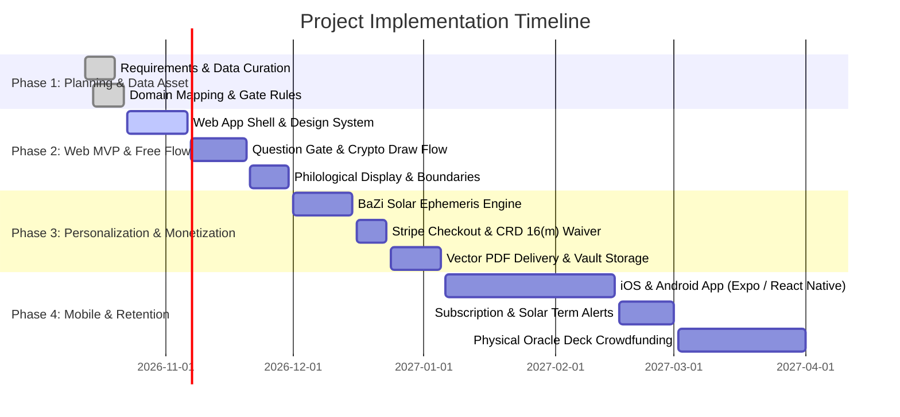

# 07. Project Roadmap & Implementation Milestones

This document outlines the phased execution strategy for **The Sixty Jiazi Lots of the Mazu Temple Tradition (六十甲子妈祖灵签)** across Web, Mobile, and Desktop platforms.

---

## 1. Phased Delivery Overview

---

## 2. Phase Breakdown

### Phase 1: Planning, Legal Guardrails & Data Ingestion (Current)
- [x] Complete PRD and 10-step UX architecture ([01_PRODUCT_REQUIREMENTS_DOCUMENT.md](./01_PRODUCT_REQUIREMENTS_DOCUMENT.md), [02_TEN_STEP_USER_JOURNEY_SPEC.md](./02_TEN_STEP_USER_JOURNEY_SPEC.md)).
- [x] Formulate the Personalization Algorithm (Lot Jiazi × Natal BaZi × Annual Pillar in [03_PERSONALIZATION_ENGINE_SPEC.md](./03_PERSONALIZATION_ENGINE_SPEC.md)).
- [x] Finalize the 29-to-11+ Domain Mapping and Question Gate specifications in [04_DOMAIN_MAPPING_AND_QUESTION_GATE.md](./04_DOMAIN_MAPPING_AND_QUESTION_GATE.md).
- [x] Legal, compliance, and CRD Art. 16(m) waiver design in [06_COMPLIANCE_LEGAL_AND_PAYMENTS.md](./06_COMPLIANCE_LEGAL_AND_PAYMENTS.md).
- [ ] Ingest the verified dataset: 60 classical Chinese verses, unrhymed English translations, historical allusions, polysemy notes, and `类目映射_29类目_to_slots.csv`.

### Phase 2: Web MVP & Leg 1 Free Draw Experience ($0)
- Build the web design system (responsive, dark-mode heritage aesthetics, typography, micro-interactions).
- Implement the Landing Page with the permanent anchor: *"Cultural heritage and reflective guidance — not a prediction of events"*.
- Implement the **Domain Picker** and **Question Gate (AI Pre-flight reframer)**.
- Implement the **Ritualized Draw Animation** (2–3 second bamboo cylinder shaking with `crypto.getRandomValues(1..60)` and session lock).
- Build the **Lot Reveal Card** & **Free Reading Layer** (domain guidance, FAVOURABLE/GUARDED keyword clusters, polysemy notes, boundaries card, automated disclaimers).
- Deploy SEO assets (`llms.txt`, OpenGraph tags, sitemaps, semantic schema markup).

### Phase 3: Leg 2 Personalization Engine & E-Commerce ($2.99 – $19.99)
- Build the **Paywall Transition Hook** directly below the free reading.
- Implement the **Four Pillars Natal Chart Engine** (Julian Day, True Solar Time calculation, Ten Gods, Five Elements).
- Implement the **Cross-Matrix Calculation Engine** (Stem Combinations/Clashes, Branch Harmonies/Clashes/Punishments).
- Integrate **Stripe Payment Elements** (Credit card, Apple Pay, Google Pay).
- Enforce the mandatory EU **CRD Art. 16(m) Waiver Checkbox** and dispatch audit receipts.
- Implement headless vector PDF generation (emailed + saved to user dashboard).

### Phase 4: Leg 3 Mobile Apps & Subscription Retention ($9.99 – $11.99/mo)
- Package the shared TypeScript core for **iOS and Android** via React Native (Expo).
- Add native device haptics for cylinder shaking.
- Implement **Daily/Weekly Practice** and **Solar Term Push Notifications**.
- Build the **Annual Birthday Transit Forecast Report** (repurchase trigger).
- Optional Desktop distribution (Tauri wrapper for Windows & macOS).

### Phase 5: Physical Artifacts & Brand Expansion
- Design the **60-Card Gold-Foil Oracle Deck** (physical cards with classical calligraphy, English translation, and QR link).
- Publish the English Companion Guidebook.
- Launch crowdfunding campaign (Kickstarter / BackerKit) targeting diaspora and mindful divination collectors.

---

## 3. Related Planning Documents (Relative Links)
- [00. Executive Summary](./00_EXECUTIVE_SUMMARY.md)
- [01. Product Requirements Document](./01_PRODUCT_REQUIREMENTS_DOCUMENT.md)
- [02. Ten-Step User Journey Specification](./02_TEN_STEP_USER_JOURNEY_SPEC.md)
- [03. Personalization Engine Specification](./03_PERSONALIZATION_ENGINE_SPEC.md)
- [04. Domain Mapping & Question Gate Specification](./04_DOMAIN_MAPPING_AND_QUESTION_GATE.md)
- [05. Technical Architecture & Multi-Platform Strategy](./05_TECHNICAL_ARCHITECTURE_AND_MULTI_PLATFORM.md)
- [06. Compliance, Legal & Payment Specifications](./06_COMPLIANCE_LEGAL_AND_PAYMENTS.md)
- [Root README](../../README.md)
