# 11. Sixty Jiazi Lot Card Artwork Catalog & Inventory

> **Artwork Standard**: Esoteric Night & Gold Line-Art on Obsidian Canvas, Universal Arabic Numeral at Top, Cinnabar Red Ancient Qin Seal Script (秦小篆) Stamp, Central Astrological Mandala, Gold Traditional Chinese Characters, and Refined English Serif Title.

---

## 1. Gallery of Completed Card Artworks (Lots 1–10 & Lot 17)

| Card | Numeral | 4-Char Qin Seal (秦小篆 2×2) | Traditional Chinese Title | English Translation & Subtitle | Primary Archetype / Narrative |
| :---: | :---: | :---: | :---: | :---: | :---: |
| 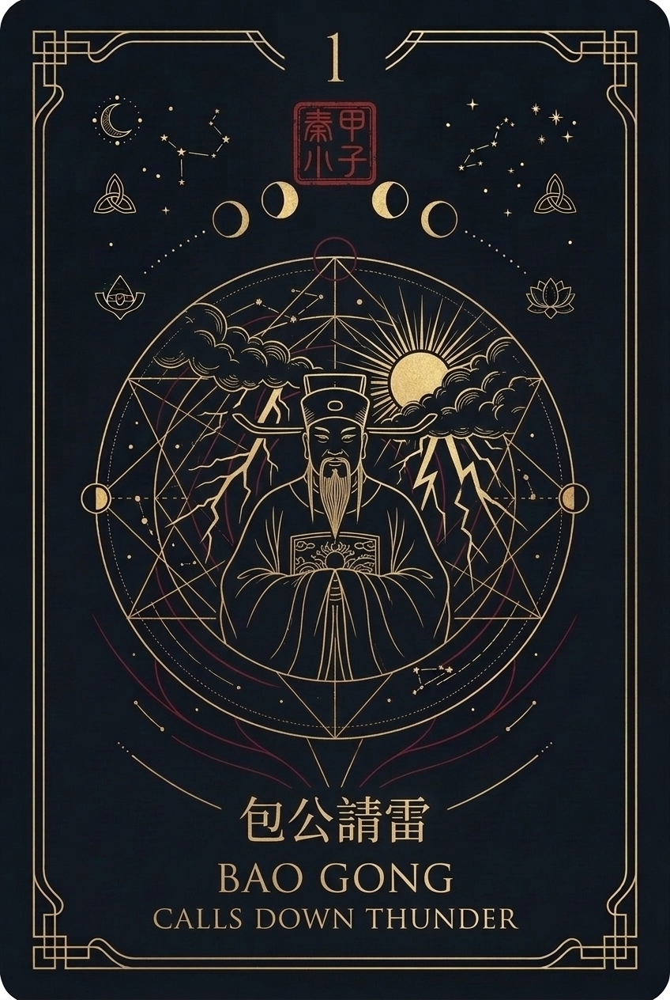 | **1** | **甲子零一** | 包公請雷 | **BAO GONG** *CALLS DOWN THUNDER* | Celestial magistrate invoking thunder to dispel doubt; clearing skies. |
| 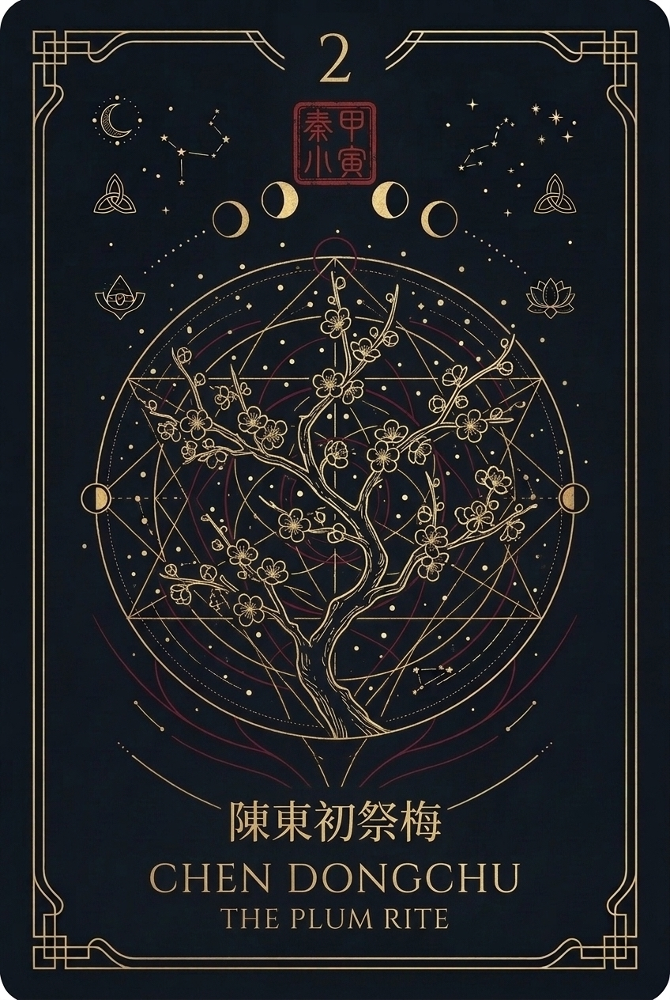 | **2** | **甲寅零二** | 陳東初祭梅 | **CHEN DONGCHU** *THE PLUM RITE* | Resilient plum tree blooming twice in snow; timely revival of fortune. |
| 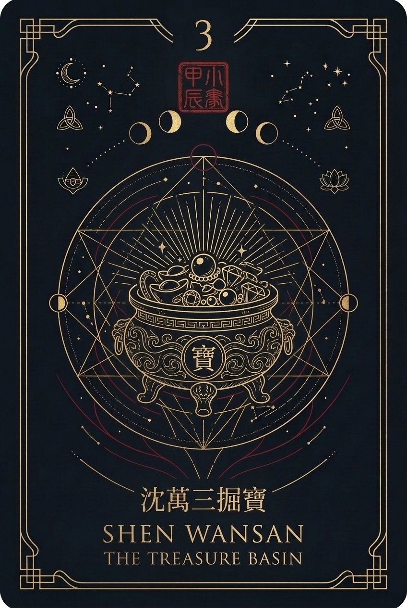 | **3** | **甲辰零三** | 沈萬三掘寶 | **SHEN WANSAN** *THE TREASURE BASIN* | Mystical treasure basin overflowing with pearls; diligent wealth accumulation. |
| 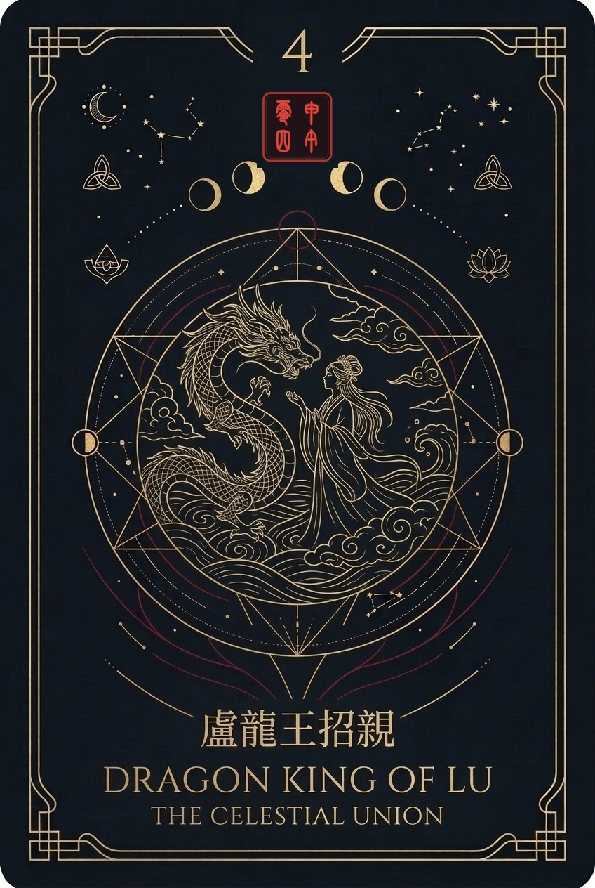 | **4** | **甲午零四** | 盧龍王招親 | **DRAGON KING OF LU** *THE CELESTIAL UNION* | Dragon prince and ocean maiden across calm water waves; harmonious consensus. |
| 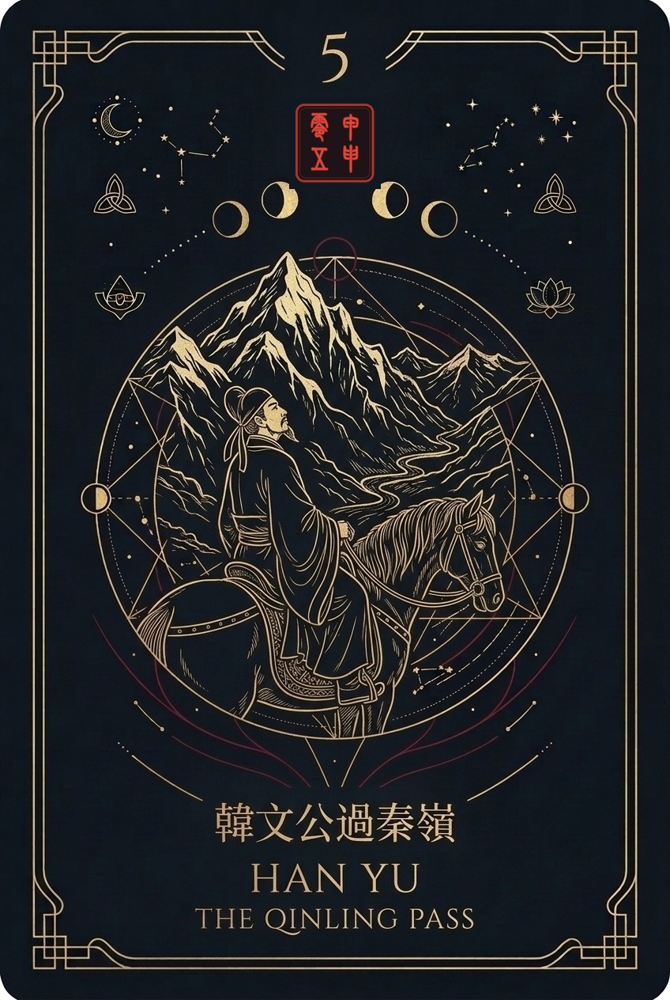 | **5** | **甲申零五** | 韓文公過秦嶺 | **HAN YU** *THE QINLING PASS* | Scholar on horseback confronting towering snowy crags; patience before advance. |
| 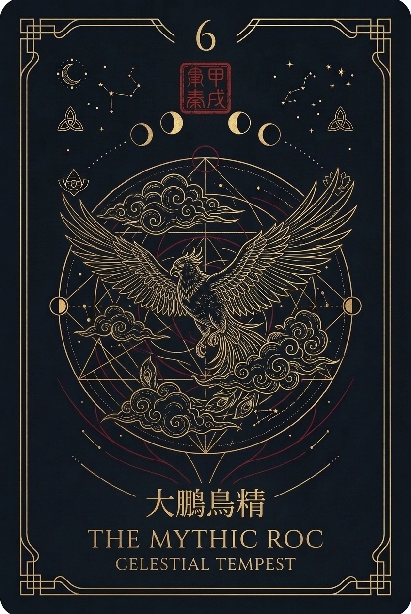 | **6** | **甲戌零六** | 大鵬鳥精 | **THE MYTHIC ROC** *CELESTIAL TEMPEST* | Giant cosmic Roc soaring through swirling storm clouds; decisive breakthrough. |
| 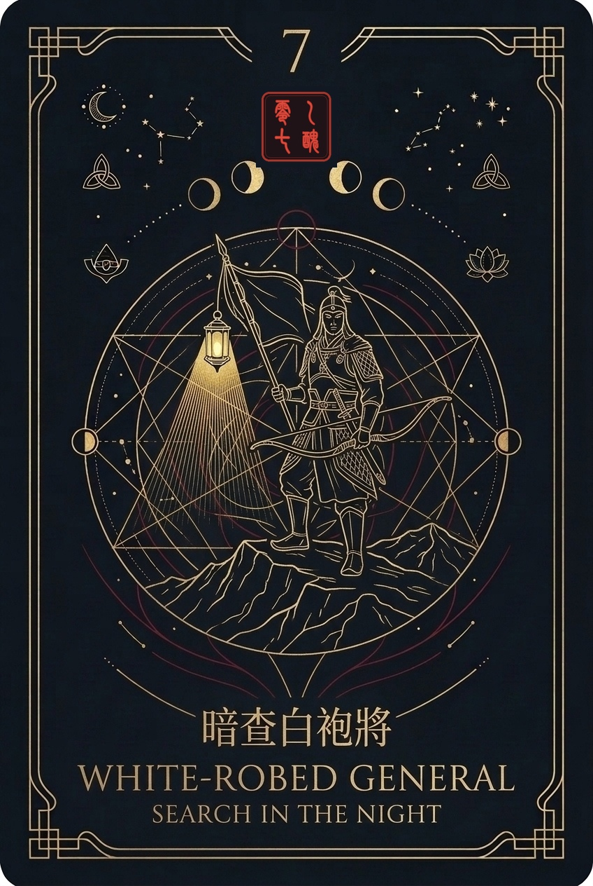 | **7** | **乙丑零七** | 暗查白袍將 | **WHITE-ROBED GENERAL** *SEARCH IN THE NIGHT* | Lantern search on nocturnal mountain ridge; discovering hidden greatness. |
| 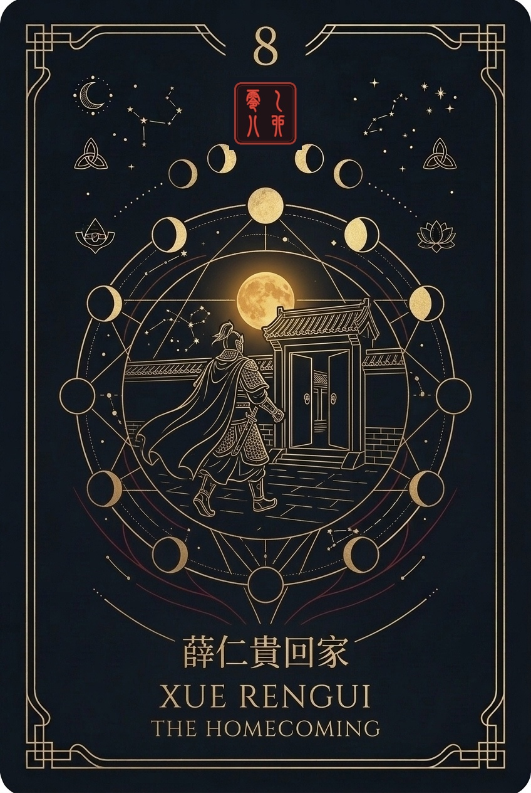 | **8** | **乙卯零八** | 薛仁貴回家 | **XUE RENGUI** *THE HOMECOMING* | Returning victorious to family courtyard under full moon; peaceful reunion. |
| 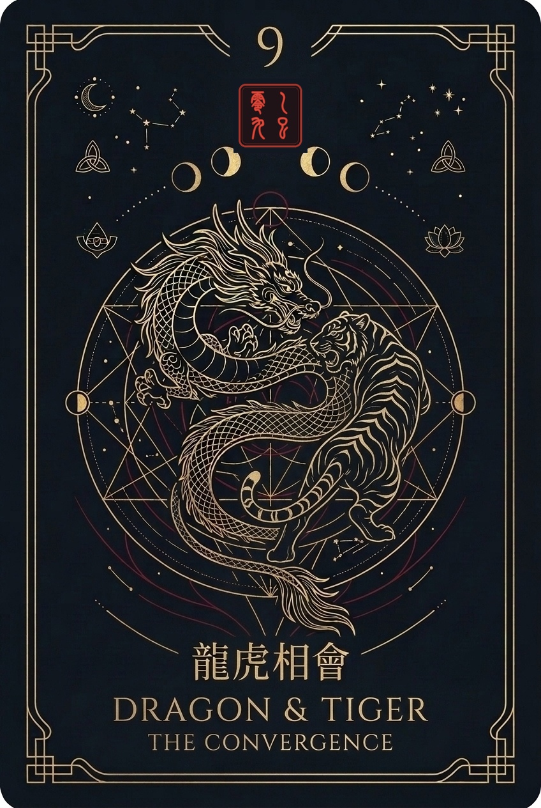 | **9** | **乙巳零九** | 龍虎相會 | **DRAGON & TIGER** *THE CONVERGENCE* | Azure Dragon and White Tiger in dynamic equilibrium; yin-yang harmony. |
| 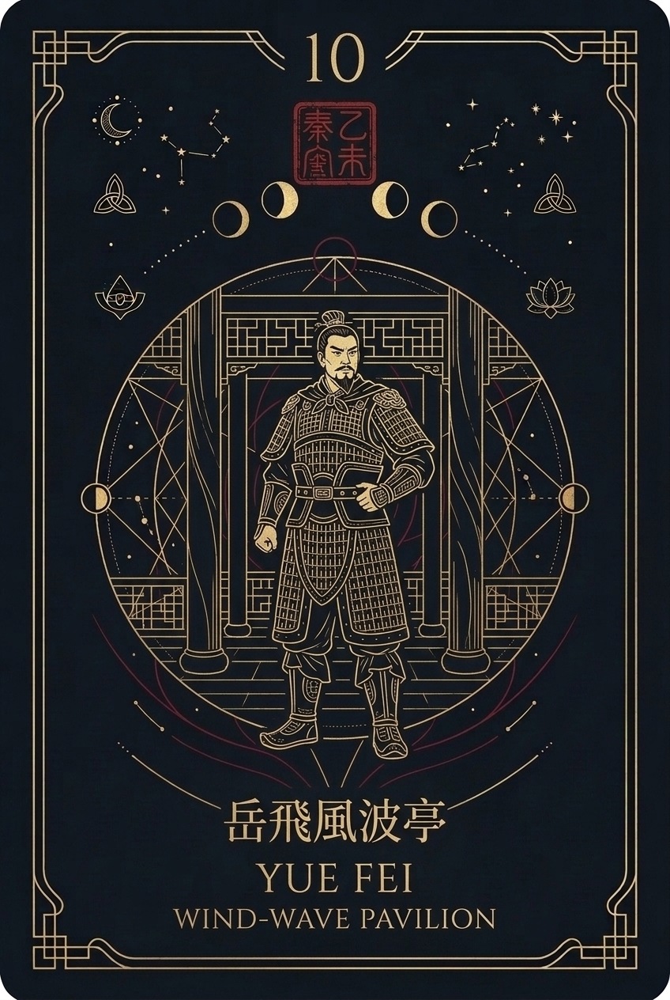 | **10** | **乙未一零** | 岳飛風波亭 | **YUE FEI** *WIND-WAVE PAVILION* | Steadfast general before wind-swept pillars; unyielding integrity. |
| 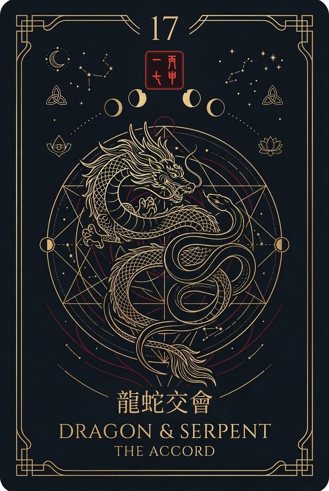 | **17** | **丙申一七** | 龍蛇交會 | **DRAGON & SERPENT** *THE ACCORD* | Intertwining celestial dragon and serpent; overcoming grievances into accord. |

---

## 2. Complete 60-Card Production Specifications (Master Registry)

All remaining cards follow the canonical dataset extracted from [`data/canonical/lots_compiled.json`](../../data/canonical/lots_compiled.json):

| Lot | Ganzhi | 4-Char Qin Seal (秦小篆) | Hexagram | Element | Canonical Story Title (ZH) | Translated Title (EN) | Visual Artwork Motif |
| :---: | :---: | :---: | :---: | :---: | :--- | :--- | :--- |
| **01** | 甲子 | **甲子零一** | 乾为天 | 金 | 包公請雷驚仁宗 | Bao Gong Calls Down Thunder | Celestial magistrate, lightning, parting storm clouds *(Completed)* |
| **02** | 甲寅 | **甲寅零二** | 水山蹇 | 水 | 陳東初祭梅得救 | Chen Dongchu's Plum Rite | Winter plum blooming in snow, celestial rescue *(Completed)* |
| **03** | 甲辰 | **甲辰零三** | 天水讼 | 火 | 沈萬三掘寶 | Shen Wansan's Treasure Basin | Mystic overflowing treasure basin, pearls *(Completed)* |
| **04** | 甲午 | **甲午零四** | 地泽临 | 金 | 盧龍王次子招親 | Dragon King of Lu | Dragon Prince and bride on calm ocean waves *(Completed)* |
| **05** | 甲申 | **甲申零五** | 泽火革 | 水 | 韓文公過秦嶺遇雪 | Han Yu at Qinling Pass | Traveler on horseback facing snowy peaks *(Completed)* |
| **06** | 甲戌 | **甲戌零六** | 山风蛊 | 水 | 大鵬鳥精亂宋朝 | The Mythic Roc | Giant golden Roc soaring through celestial gales *(Completed)* |
| **07** | 乙丑 | **乙丑零七** | 地风升 | 土 | 國公暗查白袍將 | Search for White-Robed General | Lantern search on night mountain ridge, archer *(Completed)* |
| **08** | 乙卯 | **乙卯零八** | 风山渐 | 水 | 薛仁貴回家 | Xue Rengui's Homecoming | Victorious traveler at family gate, full moon *(Completed)* |
| **09** | 乙巳 | **乙巳零九** | 天风姤 | 木 | 龍虎相會 | Dragon & Tiger Meet | Azure Dragon & White Tiger cosmic circle *(Completed)* |
| **10** | 乙未 | **乙未一零** | 雷火丰 | 金 | 岳武穆王被害 | Yue Fei at Wind-Wave Pavilion | Steadfast armored general before pavilions *(Completed)* |
| **11** | 乙酉 | **乙酉一一** | 风水涣 | 水 | 孟嘗君出秦 | Lord Mengchang's Escape | Hangu Pass gates opening at dawn, crowing rooster *(Completed)* |
| **12** | 乙亥 | **乙亥一二** | 火地晋 | 火 | 劉知遠戰瓜精 | Liu Zhiyuan's Night Patrol | Brave warrior holding torch and ancient military scroll *(Completed)* |
| **13** | 丙子 | **丙子一三** | 山火贲 | 水 | 撐渡伯遇桃花 | The Ferryman & Peach Blossom | Old wooden boat poling across floating blossom waters *(Completed)* |
| **14** | 丙寅 | **丙寅一四** | 风火家人 | 火 | 桃園三結義 | The Peach Garden Oath | Three sworn brothers raising wine bowls in blooming orchard *(Completed)* |
| **15** | 丙辰 | **丙辰一五** | 雷水解 | 土 | 渭水河太公釣魚 | Jiang Taigong Fishes on the Wei | Wise elder seated on riverbank with straight line, king approaching *(Completed)* |
| **16** | 丙午 | **丙午一六** | 地火明夷 | 水 | 李世民遊地府 | Emperor Taizong in Underworld | Imperial golden dragon aura guiding path through shadows *(Completed)* |
| **17** | 丙申 | **丙申一七** | 风泽中孚 | 火 | 龍蛇交會 (莊子試妻) | Dragon & Serpent Accord | Intertwining celestial dragon and serpent spiral *(Completed)* |
| **18** | 丙戌 | **丙戌一八** | 泽火革 | 土 | 楊管醉走白鶴樓 | Yang Guan at White Crane Pavilion | Flying celestial white crane circling a mountain pavilion *(Completed)* |
| **19** | 丁丑 | **丁丑一九** | 火水未济 | 水 | 紅孩兒截住路頭 | Red Boy Blocks the Road | Fiery lotus child wielding spear amidst divine flames *(Completed)* |
| **20** | 丁卯 | **丁卯二零** | 天地否 | 金 | 孫悟空大難火燒葫蘆 | Monkey King in Golden Gourd | Sun Wukong leaping from celestial crucible with fiery eyes *(Completed)* |
| **21** | 丁巳 | **丁巳二一** | 火风鼎 | 土 | 趙匡胤困焦贊 | Zhao Kuangyin Encircles Jiao Zan | Battle flags and walled fortress beneath starry skies *(Completed)* |
| **22** | 丁未 | **丁未二二** | 泽风大过 | 水 | 王翦戰李牧 | Wang Jian and Li Mu | Two legendary strategists surveying battlefield terrain *(Completed)* |
| **23** | 丁酉 | **丁酉二三** | 火泽睽 | 火 | 周子羽走國入陳 | Zhou Ziyu Seeks Refuge | Lone chariot traveling across open autumn plains *(Completed)* |
| **24** | 丁亥 | **丁亥二四** | 火天大有 | 金 | 孟良焦贊救宗寶 | Rescue of Yang Zongbao | Valorous rescue cavalry galloping under the northern star *(Completed)* |
| **25** | 戊子 | **戊子二五** | 雷地豫 | 火 | 孟姜女送寒衣 | Meng Jiangnu at the Great Wall | Devoted traveler carrying garments before towering stone wall *(Completed)* |
| **26** | 戊寅 | **戊寅二六** | 天泽履 | 土 | 范丹問佛 | Fan Dan Inquires of the Buddha | Humble scholar conversing with serene golden Buddha seated in lotus *(Completed)* |
| **27** | 戊辰 | **戊辰二七** | 泽天夬 | 木 | 胡完救文氏母女 | Hu Wan Rescues Widow Wen | Loyal guardian guiding lantern through bamboo groves at night *(Completed)* |
| **28** | 戊午 | **戊午二八** | 雷火丰 | 火 | 李存孝打虎 | Li Cunxiao Subdues the Tiger | Mythic youthful hero wrestling golden tiger on rocky crag *(Completed)* |
| **29** | 戊申 | **戊申二九** | 地泽临 | 土 | 趙子龍救阿斗 | Zhao Zilong at Changban Slope | Gallant armored general galloping through battle carrying infant *(Completed)* |
| **30** | 戊戌 | **戊戌三零** | 天水讼 | 木 | 豬八戒大鬧爛柿山 | Pigsy at Rotten Persimmon Hill | Mountain pass carved open through ancient misty forest *(Completed)* |
| **31** | 己丑 | **己丑三一** | 山泽损 | 水 | 孟姜女招親 | Meng Jiangnu's Betrothal | Traditional red lantern wedding archway in ancient village *(Completed)* |
| **32** | 己卯 | **己卯三二** | 风火家人 | 土 | 常何薦馬周 | Chang He Recommends Ma Zhou | Brilliant scholar presenting imperial memorial at court *(Completed)* |
| **33** | 己巳 | **己巳三三** | 天水讼 | 金 | 鮑叔牙薦管仲 | Bao Shuya Backs Guan Zhong | Two sworn statesmen clasping hands beneath ancient pine *(Completed)* |
| **34** | 己未 | **己未三四** | 火风鼎 | 火 | 蕭何追韓信 | Xiao He Chases Han Xin | Galloping horseman pursuing traveler beneath crescent moon *(Completed)* |
| **35** | 己酉 | **己酉三五** | 风天小畜 | 土 | 吳漢殺妻 | Wu Han's Moral Ordeal | Sword resting on altar table beside incense and ancestral tablets *(Completed)* |
| **36** | 己亥 | **己亥三六** | 火水未济 | 木 | 薛仁貴救駕 | Xue Rengui Rescues the Emperor | Archer piercing through enemy ranks to shield the imperial chariot *(Completed)* |
| **37** | 庚子 | **庚子三七** | 山天大畜 | 金 | 正德君看大龜 | Zhengde Emperor and Sacred Turtle | Ancient giant tortoise rising from lotus pool holding jade tablet *(Completed)* |
| **38** | 庚寅 | **庚寅三八** | 火水未济 | 木 | 劉備三請諸葛亮 | Liu Bei's Three Visits | Snow-covered thatched cottage in Longzhong, three figures waiting *(Completed)* |
| **39** | 庚辰 | **庚辰三九** | 天泽履 | 金 | 楊文廣破飛鵝山 | Yang Wenguang at Flying Goose Hill | Young general standing victorious atop mountain peak under sun *(Completed)* |
| **40** | 庚午 | **庚午四零** | 雷风恒 | 土 | 包公斷真假牡丹 | Bao Gong and the Two Peonies | Magistrate examining two identical glowing golden peony flowers *(Completed)* |
| **41** | 庚申 | **庚申四一** | 泽雷随 | 木 | 王孝先為民祈雨 | Wang Xiaoxian Prays for Rain | Daoist sage on ritual altar summoning life-giving rain clouds *(Completed)* |
| **42** | 庚戌 | **庚戌四二** | 水天需 | 金 | 姜女尋夫 | Lady Meng Seeks Her Husband | Winding mountain trail leading toward distant horizon *(Completed)* |
| **43** | 辛丑 | **辛丑四三** | 天雷无妄 | 土 | 蘇秦回家假不第 | Su Qin's Return Home | Weary scholar walking with scroll bags into village gate *(Completed)* |
| **44** | 辛卯 | **辛卯四四** | 风泽中孚 | 木 | 洪益春留傘愛陳三 | Umbrella in Lantern Festival | Two lovers under oiled-paper umbrella amidst glowing festival lanterns *(Completed)* |
| **45** | 辛巳 | **辛巳四五** | 风泽中孚 | 火 | 莊子試妻 | Zhuangzi Tests His Wife | Butterfly fluttering over stone tomb and incense burner *(Completed)* |
| **46** | 辛未 | **辛未四六** | 泽火革 | 土 | 江中立中狀元 | Jiang Zhongli Claims First Scholar | Scholar ascending palace steps adorned in crimson robes and gold flowers *(Completed)* |
| **47** | 辛酉 | **辛酉四七** | 天地否 | 木 | 高祖封韓信 | Han Xin Invested as General | Imperial altar platform, general receiving bronze military seals *(Completed)* |
| **48** | 辛亥 | **辛亥四八** | 水地比 | 金 | 班超投筆從戎 | Ban Chao Casts Aside the Brush | Scholar throwing calligraphy brush onto desk and taking up spear *(Completed)* |
| **49** | 壬子 | **壬子四九** | 地雷复 | 木 | 蘇武牧羊 | Su Wu Shepherds Sheep | Lone faithful exile holding imperial rod amidst northern snows *(Completed)* |
| **50** | 壬寅 | **壬寅五零** | 地风升 | 火 | 小兒路遇孔子 | Xiang Tuo Meets Confucius | Clever child challenging carriage of sage Confucius with riddles *(Completed)* |
| **51** | 壬辰 | **壬辰五一** | 泽地萃 | 金 | 東坡看雙姝 | Su Dongpo and the Two Sisters | Literary master composing verses in bamboo pavilion by lotus pond *(Completed)* |
| **52** | 壬午 | **壬午五二** | 水山蹇 | 土 | 宋江走安東 | Song Jiang Flees to Andong | Traveling boat drifting down reeds river at misty dusk *(Completed)* |
| **53** | 壬申 | **壬申五三** | 雷天大壮 | 金 | 蘇秦夫妻相會 | Su Qin's Joyful Reunion | Statesman adorned with six prime minister seals embracing wife *(Completed)* |
| **54** | 壬戌 | **壬戌五四** | 水天需 | 水 | 念月英相哥 | Nian Yueying and Her Suitor | Maiden looking out carved wooden window at moonlit river *(Completed)* |
| **55** | 癸丑 | **癸丑五五** | 地山谦 | 木 | 郭巨埋兒得金 | Guo Ju Unearths Gold | Filial son digging earth, unearthing glowing vase of golden coins *(Completed)* |
| **56** | 癸卯 | **癸卯五六** | 天泽履 | 金 | 范蠡歸湖 | Fan Li Sails into the Mist | Wise minister poling solitary boat across serene misty lake *(Completed)* |
| **57** | 癸巳 | **癸巳五七** | 地风升 | 水 | 董永皇陵賣身 | Dong Yong and the Silk Maiden | Celestial weaving fairy descending on rainbow cloud to reward filial son *(Completed)* |
| **58** | 癸未 | **癸未五八** | 山风蛊 | 木 | 袁達入關受挫 | Yuan Da Confronts the Pass | Armored warrior facing impenetrable mountain citadel walls *(Completed)* |
| **59** | 癸酉 | **癸酉五九** | 泽风大过 | 金 | 皇叔別徐庶 | Liu Bei Parts with Xu Shu | Lord and strategist bowing farewell on horseback beneath weeping willow *(Completed)* |
| **60** | 癸亥 | **癸亥六零** | 坤为地 | 水 | 薛剛踢死皇子 | Xue Gang at Lantern Festival | Rousing night festival with dragon dances, lanterns, and sudden twists *(Completed)* |

---

## 3. Planning Navigation (Relative Links)
- [00. Executive Summary](./00_EXECUTIVE_SUMMARY.md)
- [01. Product Requirements Document](./01_PRODUCT_REQUIREMENTS_DOCUMENT.md)
- [02. Ten-Step User Journey Specification](./02_TEN_STEP_USER_JOURNEY_SPEC.md)
- [03. Personalization Engine Specification](./03_PERSONALIZATION_ENGINE_SPEC.md)
- [04. Domain Mapping & Question Gate Specification](./04_DOMAIN_MAPPING_AND_QUESTION_GATE.md)
- [05. Technical Architecture & Multi-Platform Strategy](./05_TECHNICAL_ARCHITECTURE_AND_MULTI_PLATFORM.md)
- [06. Compliance, Legal & Payment Specifications](./06_COMPLIANCE_LEGAL_AND_PAYMENTS.md)
- [07. Project Roadmap & Milestones](./07_PROJECT_ROADMAP_AND_MILESTONES.md)
- [08. Canonical Data Schema & API Visibility Specification](./08_CANONICAL_DATA_SCHEMA_AND_API_VISIBILITY.md)
- [09. Visual Design System & Aesthetic Theme Synthesis](./09_VISUAL_DESIGN_SYSTEM_AND_THEMES.md)
- [10. UI Page Mockups & Functional Flows](./10_UI_PAGE_MOCKUPS_AND_FUNCTIONAL_FLOWS.md)
- [11. Lot Card Artwork Catalog & Inventory](./11_LOT_CARD_ARTWORK_CATALOG.md)
- [Root README](../../README.md)
